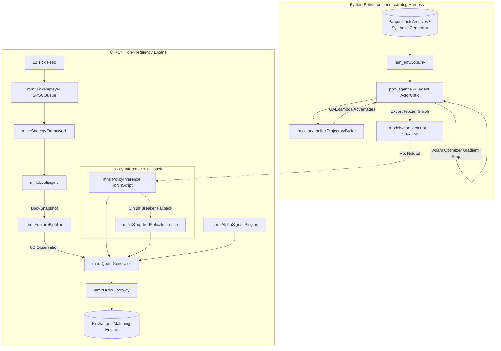
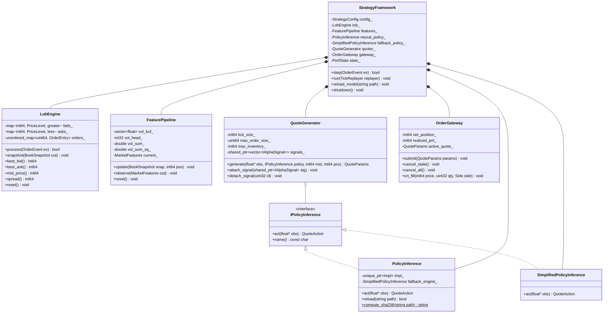

# System Architecture & Technical Design Document
**Project:** RL-Driven Adaptive Market Making Engine (`mm_engine` / `LOB.0`)  
**Cross-References:** [PROJECT_COMPLETE_UNDERSTANDING.md](file:///c:/Users/saura/Coding/SSProjects/LOB.0/PROJECT_COMPLETE_UNDERSTANDING.md) | [PROJECT_FILE_MAP.md](file:///c:/Users/saura/Coding/SSProjects/LOB.0/PROJECT_FILE_MAP.md)

---

## 1. Executive Architecture Overview

The system is a **hybrid C++17 / Python PyTorch** ultra-low-latency algorithmic market-making engine. It operates in two complementary modes:
1. **Python RL Training Harness (Offline / Asynchronous):** Collects market state transitions in a Gymnasium-compatible environment (`LobEnv`), optimizes policy and value networks using Proximal Policy Optimization (PPO) with Generalized Advantage Estimation (GAE-$\lambda$), and exports the frozen actor policy as a TorchScript binary (`.pt`) alongside its SHA-256 integrity digest.
2. **C++17 Native High-Frequency Execution Engine (Online / Sub-Microsecond):** Ingests L2 order book events via a lock-free SPSC ring buffer (`TickReplayer`), updates a price-time priority Limit Order Book (`LobEngine`), calculates an 8-dimensional normalized feature vector (`FeaturePipeline`), evaluates the neural policy or analytical fallback (`PolicyInference`), applies safety rules and alpha signals (`QuoteGenerator`), and transmits quote orders to the execution gateway (`OrderGateway`).



---

## 2. Core Architectural Subsystems

### 2.1 Limit Order Book Core Subsystem
- **Class:** [`mm::LobEngine`](file:///c:/Users/saura/Coding/SSProjects/LOB.0/include/mm/lob_engine.hpp) (in [`src/cpp/lob_engine.cpp`](file:///c:/Users/saura/Coding/SSProjects/LOB.0/src/cpp/lob_engine.cpp))
- **Data Structures:**
  - `bids_`: `std::map<int64_t, PriceLevel, std::greater<int64_t>>` (descending sorted tree; O(1) best bid access via `bids_.begin()`).
  - `asks_`: `std::map<int64_t, PriceLevel, std::less<int64_t>>` (ascending sorted tree; O(1) best ask access via `asks_.begin()`).
  - `orders_`: `std::unordered_map<uint64_t, OrderEntry>` (O(1) average lookup for order cancellation, modification, and fill tracking).
- **Binary Memory Layout:**
  - `PriceLevel` is **cache-line aligned** (`alignas(64)`), packed to exactly 64 bytes to prevent false sharing and optimize CPU L1D cache hit rates.
  - `OrderEvent` is packed to exactly 32 bytes (`sizeof(OrderEvent) == 32`).
- **Validation Pipeline:**
  - Enforces strict monotonic timestamp sequencing (`timestamp_ns >= last_timestamp_ns_`).
  - Validates positive price (`price > 0`) and non-zero quantity (`qty > 0` for Add/Fill).
  - Crossed-book protection: rejects any Add or Modify event that would cross the opposing best price (`bid_price >= best_ask` or `ask_price <= best_bid`).

---

### 2.2 Feature Pipeline Subsystem
- **Class:** [`mm::FeaturePipeline`](file:///c:/Users/saura/Coding/SSProjects/LOB.0/include/mm/feature_pipeline.hpp) (in [`src/cpp/feature_pipeline.cpp`](file:///c:/Users/saura/Coding/SSProjects/LOB.0/src/cpp/feature_pipeline.cpp))
- **Role:** Extracts a deterministic 8-dimensional float32 observation vector $\mathbf{x} \in [-5.0, 5.0]^8$ with zero heap allocations on the hot path:
  1. `ofi_l1`: Order-flow imbalance at Level 1: $\frac{\text{bid\_qty}_0 - \text{ask\_qty}_0}{\text{bid\_qty}_0 + \text{ask\_qty}_0}$
  2. `ofi_l5`: Top-5 depth order-flow imbalance: $\frac{\sum_{i=0}^4 \text{bid\_qty}_i - \sum_{i=0}^4 \text{ask\_qty}_i}{\sum_{i=0}^4 \text{bid\_qty}_i + \sum_{i=0}^4 \text{ask\_qty}_i}$
  3. `inventory_skew`: Normalized signed inventory: $\frac{\text{net\_position}}{\text{max\_position}} \in [-1, 1]$
  4. `inventory_urgency`: Inventory absolute magnitude: $\frac{|\text{net\_position}|}{\text{max\_position}} \in [0, 1]$
  5. `vol_regime`: Rolling annualized realized volatility z-score computed via an $O(1)$ circular buffer and running sum/sum-of-squares accumulator.
  6. `micro_price_offset`: Distance between micro-price and mid-price normalized by half-spread: $\frac{\frac{P_{\text{ask}} Q_{\text{bid}} + P_{\text{bid}} Q_{\text{ask}}}{Q_{\text{bid}} + Q_{\text{ask}}} - P_{\text{mid}}}{\text{half\_spread}}$
  7. `spread_ticks`: Log-compressed bid-ask spread: $\log(1 + (\text{best\_ask} - \text{best\_bid} - 1))$
  8. `session_progress`: Elapsed trading session fraction: $\frac{t - t_{\text{start}}}{T_{\text{session}}} \in [0, 1]$

---

### 2.3 Policy Inference & Safety Fallback Subsystem
- **Classes:** [`mm::IPolicyInference`](file:///c:/Users/saura/Coding/SSProjects/LOB.0/include/mm/policy_inference.hpp), [`mm::PolicyInference`](file:///c:/Users/saura/Coding/SSProjects/LOB.0/include/mm/policy_inference.hpp), [`mm::SimplifiedPolicyInference`](file:///c:/Users/saura/Coding/SSProjects/LOB.0/include/mm/policy_inference.hpp)
- **Neural Model:** Evaluates a compiled TorchScript graph via LibTorch C++ API with `torch::NoGradGuard` and `torch::from_blob` for zero-copy tensor wrapping.
- **Model Integrity & Security:** Built-in cryptographic SHA-256 hash generator verifies `.pt` binary against `.pt.sha256` before loading into active memory.
- **Atomic Hot Reloading:** Uses `std::atomic_store` on `std::shared_ptr<torch::jit::Module>` allowing zero-downtime model updates while the trading thread executes concurrently.
- **Circuit Breaker Fallback:** If inference latency exceeds budget ($800\text{ ns}$) for $>1\%$ of events, or if non-finite/NaN features are detected, the system automatically redirects inference to `SimplifiedPolicyInference`—a closed-form analytical skewing rule:
$$\Delta_{\text{bid}} = 1.0 + 1.5 \max(0, -\text{skew}) - 0.3 \cdot \text{OFI} + 0.2 \max(0, \text{vol})$$
$$\Delta_{\text{ask}} = 1.0 + 1.5 \max(0, \text{skew}) + 0.3 \cdot \text{OFI} + 0.2 \max(0, \text{vol})$$

---

### 2.4 Quote Generation & Execution Guardrails
- **Class:** [`mm::QuoteGenerator`](file:///c:/Users/saura/Coding/SSProjects/LOB.0/include/mm/quote_generator.hpp) (in [`src/cpp/quote_generator.cpp`](file:///c:/Users/saura/Coding/SSProjects/LOB.0/src/cpp/quote_generator.cpp))
- **Execution Guardrails:**
  1. **Tick Discretization:** Maps continuous offsets to integer multiples of tick size: $P_{\text{bid}} = P_{\text{mid}} - \lfloor \Delta_{\text{bid}} \cdot \text{tick\_size} \rceil$, $P_{\text{ask}} = P_{\text{mid}} + \lfloor \Delta_{\text{ask}} \cdot \text{tick\_size} \rceil$.
  2. **Minimum Spread Invariant:** Forces $P_{\text{ask}} - P_{\text{bid}} \ge \text{tick\_size}$.
  3. **Quantity Clamping:** Clamps quote sizes to $[1, \text{max\_order\_size}]$.
  4. **Inventory Halt Rule (90% Soft Limit):** When $|\text{net\_position}| \ge 0.9 \cdot \text{max\_inventory}$:
     - If long: zeroes bid quantity ($Q_{\text{bid}} = 0$) and doubles ask spread ($2 \cdot \Delta_{\text{ask}}$) to liquidate inventory.
     - If short: zeroes ask quantity ($Q_{\text{ask}} = 0$) and doubles bid spread ($2 \cdot \Delta_{\text{bid}}$) to cover short position.
  5. **TTL Assignment:** Quotes carry `valid_until_ns = current_ts_ns + 100_000_000` ($100\text{ ms}$) to prevent stale executions.
  6. **Alpha Signal Extension Interface (`mm::IAlphaSignal`):** Lock-free copy-on-write pointer swap allows plugging auxiliary skew signals without mutex contention.

---

### 2.5 Ingestion & Lock-Free Inter-Thread Queue
- **Classes:** [`mm::SPSCQueue<T, Capacity>`](file:///c:/Users/saura/Coding/SSProjects/LOB.0/include/mm/tick_replayer.hpp), [`mm::TickReplayer`](file:///c:/Users/saura/Coding/SSProjects/LOB.0/include/mm/tick_replayer.hpp)
- **Ring Buffer Design:** Single-Producer Single-Consumer lock-free ring buffer with cache-line-aligned atomic head and tail pointers (`alignas(64) std::atomic<size_t>`). Bitwise masking `index & (Capacity - 1)` ensures $O(1)$ operations with zero branch misprediction.
- **Data Gap Protection:** Monitors timestamp differences between consecutive ticks. If $\Delta t > 1.0\text{ s}$ ($10^9\text{ ns}$), fires an emergency callback that cancels all active quotes and suspends quoting until the book is replenished with at least 3 active levels on both sides.

---

### 2.6 Reinforcement Learning Architecture (Python)
- **Classes:** [`PPOAgent`](file:///c:/Users/saura/Coding/SSProjects/LOB.0/src/python/ppo_agent.py), [`ActorCritic`](file:///c:/Users/saura/Coding/SSProjects/LOB.0/src/python/ppo_agent.py), [`TrajectoryBuffer`](file:///c:/Users/saura/Coding/SSProjects/LOB.0/src/python/trajectory_buffer.py), [`RewardShaper`](file:///c:/Users/saura/Coding/SSProjects/LOB.0/src/python/reward_shaper.py)
- **Actor-Critic Network Structure:**
  ```
  Input Observation (8D)
          │
  Linear(8 -> 256) + Tanh
          │
  Linear(256 -> 256) + Tanh  <--- Shared Representation Trunk
      ┌───┴────────────────┐
      │                    │
  Actor Head           Critic Head
  Linear(256 -> 3)     Linear(256 -> 1)
      │                    │
  Mean Vector          Scalar Value V(s)
  + Learnable log_std
  (clamped [-4, 2])
  ```
- **PPO Loss Formulation:**
  $$L_{\text{total}}(\theta) = L_{\text{clip}}(\theta) + 0.5 \cdot L_{\text{value}}(\theta) - c_{\text{entropy}} \cdot H(\pi_\theta)$$
  where:
  - $L_{\text{clip}}(\theta) = -\mathbb{E}\left[ \min\left(r_t(\theta) \hat{A}_t, \text{clip}(r_t(\theta), 1-\epsilon, 1+\epsilon) \hat{A}_t\right) \right]$
  - $L_{\text{value}}(\theta) = \frac{1}{2} \mathbb{E}\left[ (V_\theta(s_t) - R_t)^2 \right]$
  - $H(\pi_\theta) = \sum_{i=1}^3 \left( \frac{1}{2} + \frac{1}{2}\log(2\pi) + \log \sigma_i \right)$
- **Reward Signal Decomposition:**
  $$R_t = \underbrace{\Delta P_{\text{mid}} \cdot q_t}_{\text{Mark-to-Market PnL}} - \underbrace{\gamma \frac{|q_t|}{q_{\text{max}}}}_{\text{Inventory Penalty } (\le 0)} + \underbrace{Q_{\text{fill}} \cdot \frac{\text{Spread}}{2} \cdot \mathbb{I}_{\text{round\_trip}}}_{\text{Spread Capture } (\ge 0)}$$

---

## 3. Class Relationship Diagram



---

## 4. Hardware Optimization & Latency Budget

| Pipeline Step | Latency Target | Optimization Technique |
| :--- | :--- | :--- |
| **SPSC Queue Pop** | $< 15\text{ ns}$ | Lock-free atomics, `alignas(64)` cache-line separation |
| **LOB Event Validation** | $< 25\text{ ns}$ | Branch-predicted validation preflight |
| **LOB State Mutation** | $< 250\text{ ns}$ | In-place tree modification, `PriceLevel` cache alignment |
| **Feature Extraction** | $< 80\text{ ns}$ | $O(1)$ Welford circular buffer, zero heap allocations |
| **Policy Evaluation** | $< 350\text{ ns}$ | Zero-copy PyTorch tensor view (`from_blob`), CPU affinity |
| **Quote Generation & Rules** | $< 60\text{ ns}$ | Bitwise clamping, SIMD-friendly scalar arithmetic |
| **Gateway Submission** | $< 20\text{ ns}$ | Register-passed struct copying |
| **Total End-to-End Cycle** | **$< 800\text{ ns}$** | Single CPU-affinity pinned core, zero allocations |
