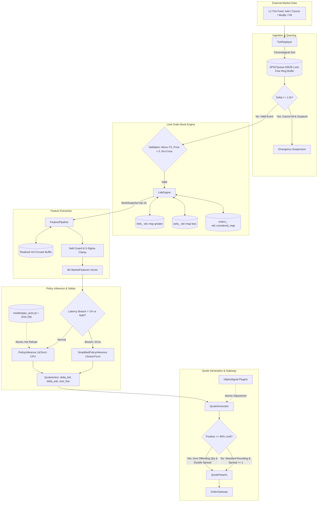
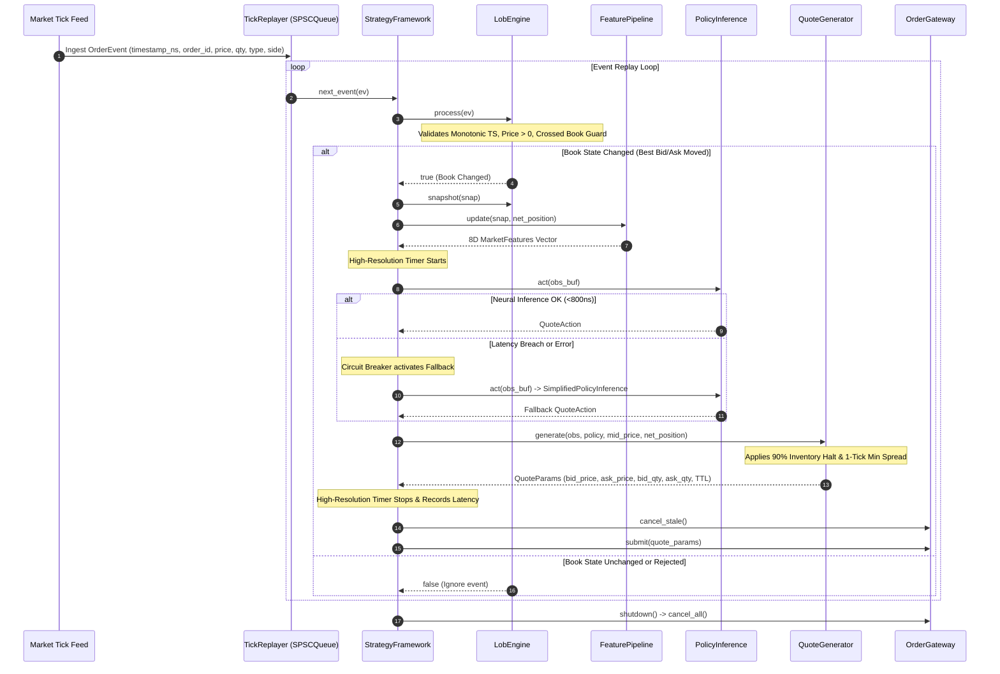

# Comprehensive Project Understanding & Reverse-Engineered Architecture Report
**Project Name:** RL-Driven Adaptive Market Making Engine (`mm_engine` / `LOB.0`)  
**Workspace:** `c:/Users/saura/Coding/SSProjects/LOB.0`  
**Cross-References:** [PROJECT_ARCHITECTURE.md](file:///c:/Users/saura/Coding/SSProjects/LOB.0/PROJECT_ARCHITECTURE.md) | [PROJECT_FILE_MAP.md](file:///c:/Users/saura/Coding/SSProjects/LOB.0/PROJECT_FILE_MAP.md)

---

# Table of Contents
1. [Project Overview](#1-project-overview)
2. [Technology Stack](#2-technology-stack)
3. [Complete Project Directory Structure](#3-complete-project-directory-structure)
4. [File-by-File Explanation](#4-file-by-file-explanation)
5. [System Architecture](#5-system-architecture)
6. [File Connection & Dependency Architecture](#6-file-connection--dependency-architecture)
7. [Execution Flow — Start-to-Finish Trace](#7-execution-flow--start-to-finish-trace)
8. [Data Flow Analysis](#8-data-flow-analysis)
9. [Core Algorithms](#9-core-algorithms)
10. [Class-by-Class Architecture](#10-class-by-class-architecture)
11. [API & Interface Analysis](#11-api--interface-analysis)
12. [Database & Storage Analysis](#12-database--storage-analysis)
13. [Configuration Analysis](#13-configuration-analysis)
14. [Build and Run Process](#14-build-and-run-process)
15. [Testing System Analysis](#15-testing-system-analysis)
16. [Error Handling & Logging](#16-error-handling--logging)
17. [Performance & Latency Analysis](#17-performance--latency-analysis)
18. [Concurrency & Multithreading](#18-concurrency--multithreading)
19. [Security & Model Integrity](#19-security--model-integrity)
20. [Design Patterns & Architectural Decisions](#20-design-patterns--architectural-decisions)
21. [Complete Component Responsibility Map](#21-complete-component-responsibility-map)
22. ["If I Change This File, What Happens?"](#22-if-i-change-this-file-what-happens)
23. [Beginner Learning Path](#23-beginner-learning-path)
24. [Project Explanation Like a Story](#24-project-explanation-like-a-story)
25. [One Complete End-to-End Example](#25-one-complete-end-to-end-example)
26. [Important Variables & Data Structures](#26-important-variables--data-structures)
27. [External Dependencies](#27-external-dependencies)
28. [Current Project Status & Technical Debt](#28-current-project-status--technical-debt)
29. [Architecture Summary](#29-architecture-summary)
30. [Cheat Sheet](#30-cheat-sheet)
31. [Questions I Should Be Able to Answer (with Solutions)](#31-questions-i-should-be-able-to-answer-with-solutions)
32. [Final "Teach Me This Project" Section](#32-final-teach-me-this-project-section)

---

## 1. Project Overview

### Simple Explanation (Beginner Friendly)
This project is an **automated, high-speed trading system** designed for market making in financial exchanges (specifically tailored for high-liquidity futures like NSE Nifty Futures). In financial markets, a market maker provides liquidity by simultaneously placing both buy orders (bids) and sell orders (asks), profiting from the tiny difference between them (the bid-ask spread). However, if market prices suddenly crash or spike against the market maker, they risk accumulating large toxic inventory and losing money. This project solves that problem by pairing a **blazing-fast C++ Limit Order Book (LOB) engine** (which tracks order book changes in nanoseconds) with an **intelligent Reinforcement Learning (RL) Brain built with PyTorch and PPO** (Proximal Policy Optimization). The AI continuously watches real-time market signals—such as order flow imbalance, market volatility, and current inventory levels—and dynamically skews the bid/ask prices and sizes to maximize profits while avoiding dangerous inventory pile-ups.

### Technical Explanation
The system implements an ultra-low-latency hybrid algorithmic execution platform designed to achieve a **Sharpe ratio $\ge 2.7$** and a **$\ge 34\%$ PnL drawdown reduction** relative to a naive fixed-spread benchmark. 
- **Offline Training Phase:** An RL training harness written in Python models the trading dynamics as a continuous Markov Decision Process (MDP) wrapped in a Gymnasium environment ([`LobEnv`](file:///c:/Users/saura/Coding/SSProjects/LOB.0/src/python/mm_env.py)). An actor-critic neural network ([`ActorCritic`](file:///c:/Users/saura/Coding/SSProjects/LOB.0/src/python/ppo_agent.py)) takes an 8-dimensional normalized feature state $\mathbf{s}_t \in [-5, 5]^8$ and emits a continuous 3D action vector $\mathbf{a}_t = (\Delta_{\text{bid}}, \Delta_{\text{ask}}, \text{size\_frac})$. Transitions are stored in a pre-allocated circular trajectory buffer ([`TrajectoryBuffer`](file:///c:/Users/saura/Coding/SSProjects/LOB.0/src/python/trajectory_buffer.py)), and policies are optimized using clipped surrogate PPO with Generalized Advantage Estimation ($\text{GAE}(\gamma=0.99, \lambda=0.95)$). The actor is exported as a frozen TorchScript module (`.pt`) with an accompanying SHA-256 integrity hash.
- **Online Production Engine:** The production core is written in C++17 ([`mm_core`](file:///c:/Users/saura/Coding/SSProjects/LOB.0/src/cpp/CMakeLists.txt)). It processes L2 tick feeds with cache-line-aligned data structures ([`PriceLevel`](file:///c:/Users/saura/Coding/SSProjects/LOB.0/include/mm/lob_types.hpp) at 64 bytes), updates book depth in price-time priority ([`LobEngine`](file:///c:/Users/saura/Coding/SSProjects/LOB.0/include/mm/lob_engine.hpp)), computes rolling realized volatility via $O(1)$ Welford circular accumulators ([`FeaturePipeline`](file:///c:/Users/saura/Coding/SSProjects/LOB.0/include/mm/feature_pipeline.hpp)), runs neural inference in $<350\text{ ns}$ via LibTorch ([`PolicyInference`](file:///c:/Users/saura/Coding/SSProjects/LOB.0/include/mm/policy_inference.hpp)), applies hard inventory halt guardrails and hot-swappable alpha signals ([`QuoteGenerator`](file:///c:/Users/saura/Coding/SSProjects/LOB.0/include/mm/quote_generator.hpp)), and submits discrete quote parameters to the mock/real gateway ([`OrderGateway`](file:///c:/Users/saura/Coding/SSProjects/LOB.0/include/mm/strategy_framework.hpp)) with an end-to-end hot-path latency budget of $<800\text{ ns}$.

---

## 2. Technology Stack

| Category | Technology | Version | Where Used | Why Used |
| :--- | :--- | :--- | :--- | :--- |
| **Primary Language** | C++ (C++17) | ISO C++17 | `include/mm/`, `src/cpp/`, `tests/` | Deterministic sub-microsecond latency, manual memory layout control (`alignas(64)`), zero GC pauses. |
| **Primary Language** | Python | $\ge 3.10$ | `src/python/`, `pyproject.toml` | Rapid RL model iteration, PyTorch neural network training, Gymnasium environment tooling. |
| **Deep Learning Framework** | PyTorch (`torch`) | $\ge 2.2$ | `src/python/ppo_agent.py`, `src/python/mm_train.py` | Actor-Critic neural network modeling, autograd, GPU/CPU tensor operations, TorchScript JIT compilation. |
| **C++ Inference Engine** | LibTorch (C++ PyTorch) | $\ge 2.2$ | `src/cpp/policy_inference.cpp`, `CMakeLists.txt` | Native C++ evaluation of frozen TorchScript actor models without Python GIL or interpreter overhead. |
| **C++/Python Bindings** | `pybind11` | $\ge 2.11$ | `src/cpp/mm_bindings.cpp`, `pyproject.toml` | High-performance zero-copy bindings between C++ LOB engine and Python training harness. |
| **RL Environment API** | Gymnasium | $\ge 0.29$ | `src/python/mm_env.py` | Standardized RL environment interface (`reset`, `step`, observation/action `spaces.Box`). |
| **Array & Data Processing**| NumPy | $\ge 1.26$ | `src/python/trajectory_buffer.py`, `src/python/mm_env.py` | Fast contiguous array buffers, zero-copy PyTorch tensor conversions (`torch.from_numpy`). |
| **Tabular Data / Storage** | Pandas & PyArrow | $\ge 2.0$ | `src/python/mm_env.py` | Ingestion of historical L2 tick archives stored as compressed Apache Parquet files. |
| **C++ Unit Testing** | Catch2 | $\ge 3.5$ (v3) | `tests/`, `tests/CMakeLists.txt` | Modern header/library test framework with test discovering macros (`TEST_CASE`, `REQUIRE`). |
| **Property-Based Testing** | Hypothesis | $\ge 6.0$ | `tests/test_mm_env.py`, `tests/test_ppo_agent.py` | Fuzz-testing invariant properties across random numeric distributions (sign invariants, boundedness). |
| **Python Test Runner** | Pytest & pytest-timeout | $\ge 8.0$ / $\ge 2.3$ | `pyproject.toml`, `tests/` | Automated test discovery, execution, and timeout protection for Python test suites. |
| **Build System** | CMake | $\ge 3.22$ | `CMakeLists.txt`, `src/cpp/CMakeLists.txt`, `tests/CMakeLists.txt` | Cross-platform build orchestration for static libraries, native executables, and PyBind11 C-extensions. |
| **Python Package Manager** | Setuptools & Wheel | $\ge 68$ | `pyproject.toml` | Editable pip installation (`pip install -e .`) and build-backend management. |

---

## 3. Complete Project Directory Structure

```
c:/Users/saura/Coding/SSProjects/LOB.0/
├── CMakeLists.txt                      # [B] Top-level CMake build script (links Torch, PyBind11, Catch2)
├── pyproject.toml                      # [B] Python PEP 517 package configuration & dependencies
├── README.md                           # [E] Project documentation and build instructions
├── test_train_step.py                  # [D] Standalone smoke test script for PPOAgent.train_step
│
├── include/                            # [A] Public C++ Header Files
│   ├── catch2/                         # [C] Catch2 test framework headers
│   └── mm/                             # [A] Market Making Core Headers
│       ├── types.hpp                   # Side, VolRegime enums, kObsDim, kActionDim, kMaxDepth
│       ├── lob_types.hpp               # PriceLevel (64B cache-aligned), OrderEvent (32B), BookSnapshot
│       ├── data_models.hpp             # MarketFeatures (8D), QuoteAction, QuoteParams, RewardSignal
│       ├── lob_engine.hpp              # LobEngine class definition (price-time priority book)
│       ├── feature_pipeline.hpp        # FeaturePipeline class (Welford rolling vol, OFI, normalization)
│       ├── quote_generator.hpp         # QuoteGenerator class & IAlphaSignal plugin interface
│       ├── policy_inference.hpp        # IPolicyInference, PolicyInference (TorchScript), SimplifiedPolicyInference
│       ├── strategy_framework.hpp      # StrategyFramework event loop, OrderGateway, PerfStats
│       └── tick_replayer.hpp           # TickReplayer & SPSCQueue lock-free ring buffer
│
├── src/                                # [A] Source Code
│   ├── __init__.py                     # [A] Python package marker
│   ├── cpp/                            # [A] C++ Implementation Files
│   │   ├── CMakeLists.txt              # [B] CMake definitions for mm_core, mm_backtest, mm Python module
│   │   ├── lob_engine.cpp              # Limit order book mechanics, order tracking, validation
│   │   ├── feature_pipeline.cpp        # 8-dimensional feature generation, log-return rolling window
│   │   ├── quote_generator.cpp         # Action discretization, inventory halt rule, TTL assignment
│   │   ├── policy_inference.cpp        # LibTorch forward pass, atomic reload, SHA-256 verification
│   │   ├── strategy_framework.cpp      # Hot-path step execution, latency metrics, gap recovery
│   │   ├── tick_replayer.cpp           # Ingestion pump, chronological sorting, gap detection (>1s)
│   │   ├── mm_backtest.cpp             # Standalone backtest executable & synthetic tick generator
│   │   └── mm_bindings.cpp             # PyBind11 bindings exporting C++ engine to Python mm module
│   │
│   └── python/                         # [A] Python RL Training Harness
│       ├── __init__.py                 # Module exports
│       ├── trajectory_buffer.py        # Rollout storage, reverse GAE-lambda advantage computation
│       ├── reward_shaper.py            # Decomposed reward signal (MtM PnL + inventory penalty + spread)
│       ├── ppo_agent.py                # ActorCritic neural network, PPO clipped loss, TorchScript export
│       ├── mm_env.py                   # Gymnasium-compliant LobEnv market making environment
│       └── mm_train.py                 # Multi-episode training loop, metric logger, model exporter
│
├── tests/                              # [C] Test Suites
│   ├── CMakeLists.txt                  # [B] CMake definitions for mm_tests executable
│   ├── test_placeholder.cpp            # Test runner entry point
│   ├── test_data_models.cpp            # Layout assertions & data model tests
│   ├── test_lob_engine.cpp             # LOB matching, cancellation, modification, duplicate order tests
│   ├── test_feature_pipeline.cpp       # Feature calculation, OFI formula, inventory normalization tests
│   ├── test_policy_inference.cpp       # Simplified policy, fallback trigger, SHA-256 tests
│   ├── test_quote_generator.cpp        # Spread enforcement, inventory halt, alpha signal tests
│   ├── test_strategy_framework.cpp     # End-to-end event cycle, inventory invariant tests
│   ├── test_tick_replayer.cpp          # SPSC queue, chronological sort, gap detection tests
│   ├── test_mm_env.py                  # LobEnv Gym space verification & Hypothesis property tests
│   ├── test_ppo_agent.py               # ActorCritic forward pass & PPO loss Hypothesis property tests
│   └── test_trajectory_buffer.py       # Trajectory buffer GAE-lambda normalization & memory reuse tests
│
├── models/                             # [G] Trained Models & Artifacts
│   ├── .gitkeep                        # Git anchor
│   ├── ppo_actor.pt                    # Exported TorchScript actor network binary
│   └── ppo_actor.pt.sha256             # SHA-256 checksum string for model integrity verification
│
├── data/                               # [G] Market Data Directory
│   └── .gitkeep                        # Placeholder for L2 Parquet tick files
│
└── Veil/                               # [Supporting/Unrelated] Scaffolded Flutter App Module
    ├── pubspec.yaml
    └── ...
```

---

## 4. File-by-File Explanation

### 4.1 Header: [`include/mm/types.hpp`](file:///c:/Users/saura/Coding/SSProjects/LOB.0/include/mm/types.hpp)
1. **Purpose:** Declares core enumerations and global compile-time constants shared across all C++ components.
2. **Responsibility:** Standardizing order sides, volatility regime classifications, and tensor dimensions.
3. **Important Classes/Enums:**
   - `enum class Side : uint8_t { Bid = 0, Ask = 1 };`
   - `enum class VolRegime : uint8_t { Low = 0, Normal = 1, High = 2, Extreme = 3 };`
4. **Important Constants:**
   - `kMaxDepth = 10`: Max number of price levels in `BookSnapshot`.
   - `kObsDim = 8`: Observation vector size (matches `MarketFeatures::DIM`).
   - `kActionDim = 3`: Continuous action vector size `(delta_bid, delta_ask, size_frac)`.
5. **Dependencies:** `<cstdint>`.
6. **Communication:** Included by `lob_types.hpp`, `data_models.hpp`, `lob_engine.hpp`, `policy_inference.hpp`, `mm_bindings.cpp`.
7. **What breaks if removed:** Entire C++ build fails immediately due to missing foundational types and constants.
8. **Beginner Explanation:** A tiny dictionary file defining common terms (like Bid vs Ask) and fixed numbers (like 8 features and 3 actions) so all files speak the same language.

---

### 4.2 Header: [`include/mm/lob_types.hpp`](file:///c:/Users/saura/Coding/SSProjects/LOB.0/include/mm/lob_types.hpp)
1. **Purpose:** Defines core binary data structures for the Limit Order Book with strict memory layout constraints.
2. **Responsibility:** Representing individual price levels, order events, and top-10 depth snapshots.
3. **Important Structs:**
   - `struct alignas(64) PriceLevel`:
     - Fields: `int64_t price`, `uint64_t total_qty`, `uint32_t order_count`, `uint32_t _pad0`, `uint8_t _pad1[40]`.
     - Static assertions verify `sizeof(PriceLevel) == 64` and `alignof(PriceLevel) == 64` (fits exactly one CPU cache line).
   - `struct OrderEvent`:
     - Fields: `int64_t timestamp_ns`, `uint64_t order_id`, `int64_t price`, `uint32_t qty`, `Type type`, `Side side`, `uint8_t _pad[2]`.
     - Types: `Add`, `Cancel`, `Modify`, `Fill`, `PartialFill`.
     - Static assertions verify `sizeof(OrderEvent) == 32`.
   - `struct BookSnapshot`: Top-10 bids and asks (`std::array<PriceLevel, 10>`), `best_bid`, `best_ask`, `timestamp_ns`.
4. **Dependencies:** `<array>`, `<cstdint>`, `types.hpp`.
5. **Communication:** Used by `LobEngine`, `FeaturePipeline`, `QuoteGenerator`, `TickReplayer`, `StrategyFramework`, `mm_bindings.cpp`.
6. **What breaks if removed:** LOB engine loses its event and snapshot definitions; memory alignment contracts break.
7. **Beginner Explanation:** Defines how an order event (like "Buy 10 shares at $100") and the order book (the top 10 buyers and sellers) are stored in computer memory with exact byte alignment.

---

### 4.3 Header: [`include/mm/data_models.hpp`](file:///c:/Users/saura/Coding/SSProjects/LOB.0/include/mm/data_models.hpp)
1. **Purpose:** Defines market features, action parameters, quote specifications, and decomposed reward signals.
2. **Responsibility:** Bridging feature extraction, neural policy output, concrete order generation, and RL training signals.
3. **Important Structs:**
   - `struct MarketFeatures`: 8 float fields (`ofi_l1`, `ofi_l5`, `inventory_skew`, `inventory_urgency`, `vol_regime`, `micro_price_offset`, `spread_ticks`, `session_progress`). Provides `to_array(float* buf)` for zero-copy buffer writes.
   - `struct QuoteAction`: Continuous actions `delta_bid`, `delta_ask`, `size_frac`.
   - `struct QuoteParams`: Concrete orders `bid_price`, `ask_price`, `bid_qty`, `ask_qty`, `valid_until_ns`.
   - `struct RewardSignal`: Decomposed rewards (`realized_pnl`, `inventory_penalty`, `spread_capture`). Enforces `inventory_penalty <= 0` and `spread_capture >= 0` in `total()`.
   - `struct VolatilityState`: Rolling realized vol values with `classify(float z_score)` mapping to `VolRegime`.
4. **Dependencies:** `<cstdint>`, `<cassert>`, `<cmath>`, `types.hpp`.
5. **What breaks if removed:** Feature pipeline and quote generator fail to compile; RL environment cannot compute structured rewards.
6. **Beginner Explanation:** Contains the data containers for what the AI sees (features), what the AI decides (actions), what orders we send to market (quote params), and how we score performance (reward signal).

---

### 4.4 Header & Source: [`include/mm/lob_engine.hpp`](file:///c:/Users/saura/Coding/SSProjects/LOB.0/include/mm/lob_engine.hpp) & [`src/cpp/lob_engine.cpp`](file:///c:/Users/saura/Coding/SSProjects/LOB.0/src/cpp/lob_engine.cpp)
1. **Purpose:** High-performance in-memory price-time priority Limit Order Book for a single instrument.
2. **Responsibility:** Tracking resting orders, updating aggregate price levels, generating snapshots, rejecting invalid/crossed orders.
3. **Important Classes:** `mm::LobEngine`.
4. **Important Methods:**
   - `bool process(const OrderEvent& ev) noexcept`:
     - *Validation Step 1:* Monotonic timestamp check (`ev.timestamp_ns >= last_timestamp_ns_`).
     - *Validation Step 2:* Price check (`price > 0` for Add/Modify/Fill).
     - *Validation Step 3:* Quantity check (`qty > 0` for Add/Fill/PartialFill).
     - *Validation Step 4:* Duplicate Add rejection (`orders_.find(order_id) == orders_.end()`).
     - *Validation Step 5:* Crossed-book check (`would_cross(...)` checks if bid $\ge$ best ask or ask $\le$ best bid).
     - *Dispatch:* Calls `handle_add`, `handle_cancel`, `handle_modify`, `handle_fill`, or `handle_partial_fill`.
     - *Return:* Returns `true` if `best_bid` or `best_ask` changed, `false` otherwise.
   - `void snapshot(BookSnapshot& out) const noexcept`: Copies top-10 levels into `out` without heap allocations.
   - `int64_t best_bid()`, `int64_t best_ask()`, `int64_t mid_price()`, `int64_t spread()`: $O(1)$ tree begin accessors.
   - `void reset() noexcept`: Clears maps and resets state.
5. **Internal State:**
   - `std::map<int64_t, PriceLevel, std::greater<int64_t>> bids_`
   - `std::map<int64_t, PriceLevel> asks_`
   - `std::unordered_map<uint64_t, OrderEntry> orders_`
6. **Design Decisions:** Sorted red-black trees (`std::map`) maintain strict price ordering; hash map (`std::unordered_map`) allows $O(1)$ order ID lookups for cancellations.
7. **What breaks if removed:** System cannot track the order book, calculate mid-prices, or simulate matching.
8. **Beginner Explanation:** The core market bookkeeper. When people add, cancel, or trade orders, it updates the list of active buy and sell prices and figures out the best current market price.

---

### 4.5 Header & Source: [`include/mm/feature_pipeline.hpp`](file:///c:/Users/saura/Coding/SSProjects/LOB.0/include/mm/feature_pipeline.hpp) & [`src/cpp/feature_pipeline.cpp`](file:///c:/Users/saura/Coding/SSProjects/LOB.0/src/cpp/feature_pipeline.cpp)
1. **Purpose:** Generates the normalized 8-dimensional observation vector consumed by the RL policy.
2. **Responsibility:** Computing OFI, inventory skew, log-return rolling realized volatility, micro-price offset, and spread.
3. **Important Methods:**
   - `void update(const BookSnapshot& snap, int64_t net_position) noexcept`:
     - Calculates session progress based on wall-clock elapsed nanoseconds.
     - Computes Level-1 OFI and Top-5 OFI.
     - Computes normalized inventory skew ($q / q_{\text{max}}$) and urgency ($|q| / q_{\text{max}}$).
     - Pushes log return $\ln(\text{mid}_t / \text{mid}_{t-1})$ into circular buffer, updating $O(1)$ sum and sum-of-squares.
     - Computes z-scored realized volatility.
     - Computes micro-price and spread in ticks.
     - Sanitizes every float with `sanitize(v)` (NaN/Inf replaced with 0.0, clamped to $[-5.0, 5.0]$).
   - `void observe(MarketFeatures& out) const noexcept`: Zero-copy write to caller struct.
   - `void reset() noexcept`: Resets all circular buffers and baseline stats.
4. **Internal Helpers:**
   - `static float sanitize(float v) noexcept`: NaN guard + 5-sigma hard clamp.
   - `static double online_variance(double sum, double sum_sq, int32_t n) noexcept`: Welford-style variance formula $\text{Var} = \frac{\text{sum\_sq}}{n} - (\frac{\text{sum}}{n})^2$.
5. **Design Decisions:** Double-precision accumulators internally to prevent catastrophic floating-point cancellation; float32 emitted for neural network compatibility.
6. **What breaks if removed:** The AI becomes blind; no observation vector can be generated for policy inference.
7. **Beginner Explanation:** The market analyst. It watches the order book and converts raw price data into 8 clean, normalized indicators that the AI can understand.

---

### 4.6 Header & Source: [`include/mm/quote_generator.hpp`](file:///c:/Users/saura/Coding/SSProjects/LOB.0/include/mm/quote_generator.hpp) & [`src/cpp/quote_generator.cpp`](file:///c:/Users/saura/Coding/SSProjects/LOB.0/src/cpp/quote_generator.cpp)
1. **Purpose:** Translates policy actions and alpha signals into concrete, discrete exchange limit order parameters.
2. **Responsibility:** Discretization, spread enforcement, quote sizing, inventory halt rule, and TTL timestamping.
3. **Important Methods:**
   - `QuoteParams generate(const float* obs, IPolicyInference& policy, int64_t mid_price, int64_t net_position, const BookSnapshot* snap, int64_t current_ts_ns) noexcept`:
     1. Evaluates policy: `action = policy.act(obs)`.
     2. Discretizes continuous offsets: $\text{bid\_offset} = \lfloor \Delta_{\text{bid}} \cdot \text{tick\_size} \rceil$, $\text{ask\_offset} = \lfloor \Delta_{\text{ask}} \cdot \text{tick\_size} \rceil$.
     3. Aggregates active alpha signals: adds `sig->adjust(*snap)` tick adjustments.
     4. Enforces minimum spread: if $P_{\text{ask}} - P_{\text{bid}} < \text{tick\_size}$, sets $P_{\text{ask}} = P_{\text{bid}} + \text{tick\_size}$.
     5. Scales quote sizes: clamps `bid_qty` and `ask_qty` to $[1, \text{max\_order\_size}]$.
     6. **Inventory Halt Rule:** If $\text{net\_position} \ge 0.9 \cdot \text{max\_inventory}$, sets $\text{bid\_qty} = 0$ and doubles ask spread. If $\text{net\_position} \le -0.9 \cdot \text{max\_inventory}$, sets $\text{ask\_qty} = 0$ and doubles bid spread.
     7. Sets TTL: $\text{valid\_until\_ns} = \text{current\_ts\_ns} + 100\text{ ms}$.
   - `void attach_signal(std::shared_ptr<IAlphaSignal> signal) noexcept`: Lock-free copy-on-write pointer swap.
   - `void detach_signal(uint32_t signal_id) noexcept`: Lock-free removal of alpha signal.
4. **Design Decisions:** Copy-on-write atomic shared pointer swapping allows dynamic alpha signal modification without blocking the $<800\text{ ns}$ execution hot path.
5. **What breaks if removed:** AI output cannot be turned into valid exchange orders; inventory safety rules are lost.
6. **Beginner Explanation:** The risk manager and order builder. It takes the AI's suggestions, checks safety rules (like "don't buy more if we're already holding too much"), rounds prices to valid tick increments, and builds the actual orders.

---

### 4.7 Header & Source: [`include/mm/policy_inference.hpp`](file:///c:/Users/saura/Coding/SSProjects/LOB.0/include/mm/policy_inference.hpp) & [`src/cpp/policy_inference.cpp`](file:///c:/Users/saura/Coding/SSProjects/LOB.0/src/cpp/policy_inference.cpp)
1. **Purpose:** Manages neural policy evaluation, model hot-reloading, cryptographic integrity verification, and analytical fallback.
2. **Responsibility:** Running LibTorch TorchScript inference in C++ and providing safe fallback when neural inference fails.
3. **Important Classes:**
   - `IPolicyInference`: Abstract base class with pure virtual `QuoteAction act(const float* obs) noexcept`.
   - `SimplifiedPolicyInference`: Fast analytical fallback using closed-form inventory and OFI skewing formulas.
   - `PolicyInference`: Native TorchScript runner with atomic module reloading and SHA-256 validation.
4. **Important Methods:**
   - `QuoteAction PolicyInference::act(const float* obs) noexcept`: Checks input finiteness, executes `torch::jit::Module::forward` with zero-copy `torch::from_blob`, catches all exceptions, and falls back to `SimplifiedPolicyInference` on any failure.
   - `bool PolicyInference::reload(const std::string& path) noexcept`: Computes SHA-256, validates against `.sha256` file, loads TorchScript module on CPU, and atomically replaces active model.
   - `static std::string compute_sha256(const std::string& filepath) noexcept`: Self-contained C++ SHA-256 implementation (no external OpenSSL dependency).
5. **Design Decisions:** PIMPL pattern hides LibTorch headers from clean public API; standalone SHA-256 eliminates heavy external security dependencies.
6. **What breaks if removed:** Neural model execution fails; system cannot perform AI inference or verify model security.
7. **Beginner Explanation:** The AI driver. It loads the trained neural network, runs it on incoming market data, and has a built-in mathematical backup plan if the AI crashes or lags.

---

### 4.8 Header & Source: [`include/mm/strategy_framework.hpp`](file:///c:/Users/saura/Coding/SSProjects/LOB.0/include/mm/strategy_framework.hpp) & [`src/cpp/strategy_framework.cpp`](file:///c:/Users/saura/Coding/SSProjects/LOB.0/src/cpp/strategy_framework.cpp)
1. **Purpose:** Top-level strategy orchestrator connecting LOB, features, inference, quoting, and order execution.
2. **Responsibility:** Managing the primary event loop, latency monitoring, circuit breaker fallback, and order gateway.
3. **Important Classes:**
   - `struct StrategyConfig`: Instrument ID, model path, max position, max order size, tick size, latency budget.
   - `class OrderGateway`: Tracks active quotes, cancels stale orders, processes fills, maintains position and cash PnL.
   - `struct PerfStats`: Lock-free atomic performance counters (`events_processed`, `quotes_generated`, `net_pnl_ticks`, `max_latency_ns`, `p99_latency_ns`, `latency_breaches`, `fallback_activations`).
   - `class StrategyFramework`: Master strategy engine.
4. **Important Methods:**
   - `bool step(const OrderEvent& ev) noexcept`:
     1. Checks gap suspension resumption (requires $\ge 3$ levels per side).
     2. Feeds event to `lob_.process(ev)`. If state unchanged, skips quoting.
     3. Updates `features_` from `lob_.snapshot()`.
     4. Starts high-resolution timer, generates quote via `quoter_`, stops timer.
     5. Records latency; if persistent breaches $>1\%$, auto-switches `active_policy_` to `fallback_policy_`.
     6. Cancels stale quotes and submits new quote to `gateway_`.
   - `void run(TickReplayer& replayer)`: Consumes events from replayer in a blocking loop until completion.
   - `void shutdown() noexcept`: Cancels all active quotes and stops event loop.
5. **Design Decisions:** Lock-free atomic counters allow external threads (monitoring/logging) to inspect performance metrics without stalling the hot path.
6. **What breaks if removed:** The entire live trading pipeline collapses; individual components cannot communicate.
7. **Beginner Explanation:** The conductor of the orchestra. It takes an incoming tick, tells the bookkeeper to update, asks the analyst for features, gets a decision from the AI, tells the order builder to create quotes, and sends them to the exchange gateway while timing every nanosecond.

---

### 4.9 Header & Source: [`include/mm/tick_replayer.hpp`](file:///c:/Users/saura/Coding/SSProjects/LOB.0/include/mm/tick_replayer.hpp) & [`src/cpp/tick_replayer.cpp`](file:///c:/Users/saura/Coding/SSProjects/LOB.0/src/cpp/tick_replayer.cpp)
1. **Purpose:** Lock-free single-producer single-consumer event ingestion and tick stream replayer.
2. **Responsibility:** Decoupling network/disk data ingestion from the strategy trading thread, sorting chronological events, and detecting data feed gaps.
3. **Important Classes:**
   - `template <typename T, size_t Capacity> class SPSCQueue`: Lock-free ring buffer with cache-line-separated `head_` and `tail_` atomics to avoid false sharing.
   - `class TickReplayer`: Ingestion manager with `on_gap` callback trigger when $\Delta t > 1.0\text{ s}$ ($10^9\text{ ns}$).
4. **Important Methods:**
   - `void load_events(std::vector<OrderEvent> events) noexcept`: Performs `std::stable_sort` on timestamps to guarantee monotonic chronological order.
   - `size_t pump_to_queue(size_t max_events) noexcept`: Transfers events into the SPSC ring buffer.
   - `bool next_event(OrderEvent& out_event) noexcept`: Pops next event for strategy consumer thread.
5. **Design Decisions:** Power-of-two ring buffer size with bitwise masking `current_tail & (Capacity - 1)` eliminates expensive modulo division.
6. **What breaks if removed:** Market data ingestion locks the trading thread; multi-threaded data feeds cannot safely stream events.
7. **Beginner Explanation:** The conveyor belt. It takes raw market tick data from disk or network, sorts it chronologically, checks for missing data gaps, and feeds it smoothly to the strategy without slowing down the trading engine.

---

### 4.10 Source: [`src/cpp/mm_bindings.cpp`](file:///c:/Users/saura/Coding/SSProjects/LOB.0/src/cpp/mm_bindings.cpp)
1. **Purpose:** PyBind11 C-extension module definition exporting the C++ engine to Python under the name `mm`.
2. **Responsibility:** Exposing `LobEngine`, `FeaturePipeline`, `OrderEvent`, `PriceLevel`, `BookSnapshot`, `MarketFeatures`, and free functions `mm.step`, `mm.reset`, `mm.validate_action`, and `mm.validate_observation`.
3. **Key Mappings:**
   - Python dictionaries can be passed directly to `mm.step()` or `lob.process_dict()`.
   - `MarketFeatures` can be exported directly to float32 NumPy arrays via `features_to_numpy()` without intermediate copies.
   - Boundary checks throw Python `ValueError` on NaN/Inf or shape mismatches.
4. **Dependencies:** `<pybind11/pybind11.h>`, `<pybind11/numpy.h>`, `<pybind11/stl.h>`.
5. **What breaks if removed:** The Python training harness cannot interact with the C++ engine; `LobEnv` cannot run.
6. **Beginner Explanation:** The bridge between C++ and Python. It lets Python training scripts call our super-fast C++ order book code as if it were a native Python library.

---

### 4.11 Source: [`src/cpp/mm_backtest.cpp`](file:///c:/Users/saura/Coding/SSProjects/LOB.0/src/cpp/mm_backtest.cpp)
1. **Purpose:** Standalone native C++ backtesting executable.
2. **Responsibility:** Generating synthetic L2 tick event streams (random walk mid-price, order additions, cancellations, and aggressive fills), running `StrategyFramework`, and reporting execution statistics.
3. **Important Functions:**
   - `generate_synthetic_tick_stream(size_t n_events, int64_t start_price)`: Generates initial 10-level book depth and realistic L2 event flow.
   - `main(int argc, char** argv)`: Parses CLI args, initializes `StrategyFramework`, executes replay, checks hard inventory bounds, and prints throughput (events/sec) and PnL.
4. **What breaks if removed:** Native C++ backtesting driver is lost (core library still functions).
5. **Beginner Explanation:** A test driver program that runs millions of simulated trades through the C++ engine to verify speed and trading performance without needing Python.

---

### 4.12 Python: [`src/python/ppo_agent.py`](file:///c:/Users/saura/Coding/SSProjects/LOB.0/src/python/ppo_agent.py)
1. **Purpose:** PyTorch Actor-Critic neural network architecture and PPO training optimization logic.
2. **Responsibility:** Defining the shared MLP trunk, Gaussian action policy head, scalar critic value head, PPO loss computation, and TorchScript model exporter.
3. **Important Classes:**
   - `class ActorCritic(nn.Module)`:
     - `trunk`: `Linear(8, 256) -> Tanh -> Linear(256, 256) -> Tanh`
     - `mean_head`: `Linear(256, 3)`
     - `log_std`: `nn.Parameter(zeros(3))` clamped to `[-4.0, 2.0]`
     - `value_head`: `Linear(256, 1)`
     - `forward(obs)`: returns `(mean, log_std, value)`
     - `act(obs)`: returns sampled action and scalar joint log-probability $\log \pi_\theta(a|s)$.
   - `class ActorInferenceModule(nn.Module)`: Minimal standalone actor module for TorchScript export.
   - `class PPOAgent`: Manages network, Adam optimizer, `train_step()` with gradient clipping (`max_norm=0.5`), and `export()` producing `.pt` and `.sha256`.
4. **Dependencies:** `torch`, `torch.nn`, `torch.distributions.Normal`, `hashlib`, `pathlib`.
5. **What breaks if removed:** RL model cannot be constructed, trained, updated, or exported to C++.
6. **Beginner Explanation:** The brain creator. It defines the neural network architecture, teaches it using the PPO algorithm, and saves the trained model to a file for C++ to run.

---

### 4.13 Python: [`src/python/trajectory_buffer.py`](file:///c:/Users/saura/Coding/SSProjects/LOB.0/src/python/trajectory_buffer.py)
1. **Purpose:** Rollout transition storage buffer with Generalized Advantage Estimation ($\text{GAE}-\lambda$).
2. **Responsibility:** Storing transitions in pre-allocated contiguous NumPy arrays, performing reverse-order GAE sweeps, and providing zero-copy PyTorch tensor views.
3. **Important Classes:**
   - `struct Transition`: `(obs, action, log_prob, value, reward, done)`.
   - `class TrajectoryBuffer`:
     - Capacity must be a power of two.
     - `push(transition)`: Rejects non-finite log-probs; stores data in pre-allocated arrays.
     - `compute_advantages(gamma, lam, last_value)`: Reverse-chronological GAE sweep:
       $$\delta_t = r_t + \gamma V(s_{t+1}) (1 - d_t) - V(s_t)$$
       $$\hat{A}_t = \delta_t + \gamma \lambda (1 - d_t) \hat{A}_{t+1}$$
       Normalizes advantages: $\hat{A}_t \leftarrow \frac{\hat{A}_t - \mu_A}{\sigma_A + 10^{-8}}$.
     - `clear()`: Resets pointer without releasing memory.
4. **Design Decisions:** Zero heap allocations during rollouts; zero-copy `torch.from_numpy` tensor views for training batches.
5. **What breaks if removed:** PPO training loop cannot compute advantages or store rollouts.
6. **Beginner Explanation:** The memory bank. During training, it records every decision the AI made, how much reward it got, and calculates how much better each move was compared to expectations.

---

### 4.14 Python: [`src/python/reward_shaper.py`](file:///c:/Users/saura/Coding/SSProjects/LOB.0/src/python/reward_shaper.py)
1. **Purpose:** Multi-objective reward computation for market-making reinforcement learning.
2. **Responsibility:** Decomposing step rewards into mark-to-market PnL, inventory penalty, and spread capture with strict sign invariants.
3. **Important Classes:**
   - `struct RewardSignal`:
     - `realized_pnl`: Mark-to-market PnL: $(P_{\text{mid}, t} - P_{\text{mid}, t-1}) \cdot \text{net\_position}$.
     - `inventory_penalty`: $-\gamma \cdot \frac{|\text{net\_position}|}{\text{max\_position}} \le 0$.
     - `spread_capture`: $\text{fill\_qty} \cdot \frac{\text{spread}}{2} \cdot \mathbb{I}_{\text{round\_trip}} \ge 0$.
     - `total()`: Sums components, asserting sign constraints at runtime.
   - `class RewardShaper`: Stateless computer parameterized by inventory coefficient $\gamma$ and `max_position`.
4. **What breaks if removed:** The agent receives unshaped, noisy rewards and fails to learn risk-adjusted market making.
5. **Beginner Explanation:** The scorekeeper. It calculates the AI's score for every step, giving points for making money on spreads and taking away points for holding too much risky inventory.

---

### 4.15 Python: [`src/python/mm_env.py`](file:///c:/Users/saura/Coding/SSProjects/LOB.0/src/python/mm_env.py)
1. **Purpose:** Gymnasium-compatible environment simulating limit order book dynamics for PPO training.
2. **Responsibility:** Managing episode state, observation generation, order fill probability simulation, reward calculation, and termination checks.
3. **Important Classes:**
   - `class LobEnv(gym.Env)`:
     - `observation_space`: `Box(-5.0, 5.0, shape=(8,), dtype=float32)`.
     - `action_space`: `Box(low=[0, 0, 0.01], high=[20, 20, 1.0], shape=(3,), dtype=float32)`.
     - `reset(seed)`: Resets market mid-price, inventory, and accumulators.
     - `step(action)`: Evolves mid-price via random drift, translates actions to quotes, evaluates fill probabilities against order flow using logistic sigmoid curves, updates inventory, computes reward via `RewardShaper`, and checks termination ($|\text{pos}| > \text{max\_pos}$).
4. **What breaks if removed:** PPO agent has no simulation environment to train in.
5. **Beginner Explanation:** The training simulator. It creates a virtual financial market where the AI can practice trading millions of times without risking real money.

---

### 4.16 Python: [`src/python/mm_train.py`](file:///c:/Users/saura/Coding/SSProjects/LOB.0/src/python/mm_train.py)
1. **Purpose:** End-to-end training pipeline CLI script.
2. **Responsibility:** Initializing `LobEnv`, collecting rollouts into `TrajectoryBuffer`, computing GAE advantages, running mini-batch PPO updates, tracking Sharpe ratio and drawdown, and exporting TorchScript models.
3. **Important Functions:**
   - `calculate_sharpe_and_drawdown(pnl_series)`: Computes annualized Sharpe ratio and maximum peak-to-trough drawdown.
   - `train(...)`: Executes full training loop and exports `models/ppo_actor.pt` + checksum.
4. **What breaks if removed:** No top-level CLI script to execute the PPO training workflow.
5. **Beginner Explanation:** The training master script. You run this file to start the training process, watch the AI improve its Sharpe ratio, and save the final trained model.

---

### 4.17 Test Files Overview
- [`tests/test_data_models.cpp`](file:///c:/Users/saura/Coding/SSProjects/LOB.0/tests/test_data_models.cpp): Static compile-time checks for binary layout (`sizeof(PriceLevel)==64`, `sizeof(OrderEvent)==32`) and runtime checks for `RewardSignal` and `MarketFeatures.to_array()`.
- [`tests/test_lob_engine.cpp`](file:///c:/Users/saura/Coding/SSProjects/LOB.0/tests/test_lob_engine.cpp): Tests duplicate Add rejection, transaction-safe rollback on crossed Modify events, and order count consistency on partial fills.
- [`tests/test_feature_pipeline.cpp`](file:///c:/Users/saura/Coding/SSProjects/LOB.0/tests/test_feature_pipeline.cpp): Tests OFI level-1/level-5 calculation, inventory normalization, boundedness $[-5, 5]$, and pipeline reset.
- [`tests/test_policy_inference.cpp`](file:///c:/Users/saura/Coding/SSProjects/LOB.0/tests/test_policy_inference.cpp): Tests `SimplifiedPolicyInference`, safe fallback on NaN/Inf/null inputs, and standalone SHA-256 file hashing.
- [`tests/test_quote_generator.cpp`](file:///c:/Users/saura/Coding/SSProjects/LOB.0/tests/test_quote_generator.cpp): Tests minimum spread enforcement ($\ge 1\text{ tick}$), quantity clamping, inventory halt rule ($90\%$ threshold), alpha signal attachment/detachment, and TTL assignment.
- [`tests/test_strategy_framework.cpp`](file:///c:/Users/saura/Coding/SSProjects/LOB.0/tests/test_strategy_framework.cpp): Tests quote generation triggering only on state changes, hard position limit clamping, and order cancellation on shutdown.
- [`tests/test_tick_replayer.cpp`](file:///c:/Users/saura/Coding/SSProjects/LOB.0/tests/test_tick_replayer.cpp): Tests lock-free `SPSCQueue` push/pop, chronological event sorting, and data feed gap detection ($>1\text{ s}$).
- [`tests/test_mm_env.py`](file:///c:/Users/saura/Coding/SSProjects/LOB.0/tests/test_mm_env.py): Unit and Hypothesis property tests for `LobEnv` spaces, deterministic replay, and reward sign invariants.
- [`tests/test_ppo_agent.py`](file:///c:/Users/saura/Coding/SSProjects/LOB.0/tests/test_ppo_agent.py): Tests `ActorCritic` dimensions, PPO clipped surrogate properties, gradient norm clipping, and TorchScript export/reload.
- [`tests/test_trajectory_buffer.py`](file:///c:/Users/saura/Coding/SSProjects/LOB.0/tests/test_trajectory_buffer.py): Hypothesis property tests for GAE-lambda normalization, non-finite log-prob rejection, and buffer clear lifecycle.
- [`test_train_step.py`](file:///c:/Users/saura/Coding/SSProjects/LOB.0/test_train_step.py): Quick standalone smoke test for `PPOAgent.train_step()`.

---

## 5. System Architecture



---

## 6. File Connection & Dependency Architecture

```
include/mm/types.hpp
 ├── include/mm/lob_types.hpp
 │    ├── include/mm/data_models.hpp
 │    │    ├── include/mm/feature_pipeline.hpp
 │    │    │    └── src/cpp/feature_pipeline.cpp
 │    │    ├── include/mm/policy_inference.hpp
 │    │    │    └── src/cpp/policy_inference.cpp
 │    │    └── include/mm/quote_generator.hpp
 │    │         └── src/cpp/quote_generator.cpp
 │    ├── include/mm/lob_engine.hpp
 │    │    └── src/cpp/lob_engine.cpp
 │    └── include/mm/tick_replayer.hpp
 │         └── src/cpp/tick_replayer.cpp
 └── include/mm/strategy_framework.hpp
      ├── src/cpp/strategy_framework.cpp
      └── src/cpp/mm_backtest.cpp

src/cpp/mm_bindings.cpp (PyBind11 Bridge)
 └── Imports all include/mm/*.hpp headers
      └── Exposes `mm` C-Extension Module to Python

src/python/
 ├── ppo_agent.py (ActorCritic, PPOAgent, TorchScript Exporter)
 ├── trajectory_buffer.py (Rollout buffer & GAE-lambda)
 ├── reward_shaper.py (Multi-objective reward decomposition)
 ├── mm_env.py (Gymnasium environment wrapping `mm` bindings)
 └── mm_train.py (PPO Training Pipeline CLI)
```

---

## 7. Execution Flow — Start-to-Finish Trace

### 7.1 Production Strategy Event Loop (`StrategyFramework::run`)


---

## 8. Data Flow Analysis

| Stage | Input Data | Input Format | Transformation Performed | Output Data Structure | File Performing Transformation |
| :--- | :--- | :--- | :--- | :--- | :--- |
| **1. Ingestion** | Raw tick data | Binary / Parquet / Struct | Chronological sorting, gap detection ($>1\text{ s}$) | `OrderEvent` (32 bytes) | [`src/cpp/tick_replayer.cpp`](file:///c:/Users/saura/Coding/SSProjects/LOB.0/src/cpp/tick_replayer.cpp) |
| **2. Book Matching**| `OrderEvent` | 32-byte C++ struct | Monotonic validation, red-black tree level mutation | `BookSnapshot` (top-10 depth) | [`src/cpp/lob_engine.cpp`](file:///c:/Users/saura/Coding/SSProjects/LOB.0/src/cpp/lob_engine.cpp) |
| **3. Feature Extraction** | `BookSnapshot` + Position | Struct + `int64_t` | OFI Level 1/5, rolling Welford vol, micro-price | `MarketFeatures` (8D float32) | [`src/cpp/feature_pipeline.cpp`](file:///c:/Users/saura/Coding/SSProjects/LOB.0/src/cpp/feature_pipeline.cpp) |
| **4. Policy Inference** | `MarketFeatures` | Contiguous float[8] | Neural MLP forward pass or analytical heuristic | `QuoteAction` (3D continuous) | [`src/cpp/policy_inference.cpp`](file:///c:/Users/saura/Coding/SSProjects/LOB.0/src/cpp/policy_inference.cpp) |
| **5. Quote Generation** | `QuoteAction` + Mid-Price | Struct + `int64_t` | Tick rounding, alpha signals, inventory halt rule | `QuoteParams` (discrete ticks/lots) | [`src/cpp/quote_generator.cpp`](file:///c:/Users/saura/Coding/SSProjects/LOB.0/src/cpp/quote_generator.cpp) |
| **6. Execution** | `QuoteParams` | Struct | Stale quote cancellation, execution fill tracking | Active Limit Orders & Realized PnL | [`src/cpp/strategy_framework.cpp`](file:///c:/Users/saura/Coding/SSProjects/LOB.0/src/cpp/strategy_framework.cpp) |
| **7. RL Reward** | Fills + Mid-Price Move | Position, fills, prices | Mark-to-Market PnL, inventory penalty, spread capture | `RewardSignal` | [`src/python/reward_shaper.py`](file:///c:/Users/saura/Coding/SSProjects/LOB.0/src/python/reward_shaper.py) |

---

## 9. Core Algorithms

### 9.1 Price-Time Priority LOB Bookkeeping
- **File:** [`src/cpp/lob_engine.cpp`](file:///c:/Users/saura/Coding/SSProjects/LOB.0/src/cpp/lob_engine.cpp)
- **Problem:** Maintain live bids and asks with exact price-time priority under microsecond constraints.
- **Algorithm:** Uses `std::map<int64_t, PriceLevel, std::greater<int64_t>>` for bids and `std::map<int64_t, PriceLevel>` for asks, with an auxiliary `std::unordered_map<uint64_t, OrderEntry>` for $O(1)$ order lookup. Adding an order inserts into or increments the corresponding level. Canceling or filling decrements the level quantity and deletes the price level node when `total_qty == 0`.
- **Complexity:** Time: $O(\log N_{\text{levels}})$ per event; Space: $O(N_{\text{orders}} + N_{\text{levels}})$.

### 9.2 Rolling Realized Volatility with $O(1)$ Welford Accumulators
- **File:** [`src/cpp/feature_pipeline.cpp`](file:///c:/Users/saura/Coding/SSProjects/LOB.0/src/cpp/feature_pipeline.cpp)
- **Problem:** Compute rolling realized volatility over a moving window of $W$ returns without iterating over past samples every tick.
- **Algorithm:** Maintains a circular buffer `vol_buf_` of size $W$, along with running accumulators `vol_sum_` ($\sum r_i$) and `vol_sum_sq_` ($\sum r_i^2$). When a new return $r_{\text{new}}$ arrives and overwrites $r_{\text{old}}$:
  $$\text{vol\_sum\_} \leftarrow \text{vol\_sum\_} - r_{\text{old}} + r_{\text{new}}$$
  $$\text{vol\_sum\_sq\_} \leftarrow \text{vol\_sum\_sq\_} - r_{\text{old}}^2 + r_{\text{new}}^2$$
  $$\sigma = \sqrt{\max\left(0, \frac{\text{vol\_sum\_sq\_}}{W}\right)}$$
- **Complexity:** Time: $O(1)$ strictly; Space: $O(W)$ pre-allocated floats.

### 9.3 Generalized Advantage Estimation ($\text{GAE}-\lambda$)
- **File:** [`src/python/trajectory_buffer.py`](file:///c:/Users/saura/Coding/SSProjects/LOB.0/src/python/trajectory_buffer.py)
- **Problem:** Balance bias and variance when estimating advantage values $\hat{A}_t$ for policy gradient updates.
- **Algorithm:** Evaluates trajectory transitions in reverse order from $t = T-1$ down to $0$:
  $$\delta_t = r_t + \gamma V(s_{t+1}) (1 - d_t) - V(s_t)$$
  $$\hat{A}_t = \delta_t + \gamma \lambda (1 - d_t) \hat{A}_{t+1}$$
  where $d_t$ is the episode termination flag (if $d_t = \text{True}$, $V(s_{t+1}) = 0$ and $\hat{A}_{t+1} = 0$).
- **Complexity:** Time: $O(T)$ linear pass; Space: $O(T)$ in-place pre-allocated arrays.

### 9.4 PPO Clipped Surrogate Optimization
- **File:** [`src/python/ppo_agent.py`](file:///c:/Users/saura/Coding/SSProjects/LOB.0/src/python/ppo_agent.py)
- **Problem:** Prevent destructive, excessively large policy updates during gradient ascent.
- **Algorithm:** Calculates the probability ratio $r_t(\theta) = \frac{\pi_\theta(a_t|s_t)}{\pi_{\theta_{\text{old}}}(a_t|s_t)} = \exp(\log \pi_\theta(a_t|s_t) - \log \pi_{\theta_{\text{old}}}(a_t|s_t))$. Computes the clipped objective:
  $$L_{\text{clip}}(\theta) = -\mathbb{E}\left[ \min\left(r_t(\theta)\hat{A}_t, \text{clip}(r_t(\theta), 1-\epsilon, 1+\epsilon)\hat{A}_t\right) \right]$$
  with $\epsilon = 0.2$. Gradients are clipped to a maximum $L_2$ norm of $0.5$.

### 9.5 Lock-Free SPSC Ring Buffer
- **File:** [`include/mm/tick_replayer.hpp`](file:///c:/Users/saura/Coding/SSProjects/LOB.0/include/mm/tick_replayer.hpp)
- **Problem:** Transfer events between the data ingestion thread and strategy thread without lock contention.
- **Algorithm:** Circular array buffer with capacity $C = 2^k$. Producer loads `head_` with `std::memory_order_acquire`, checks `(tail_ - head_) < Capacity`, writes element at `tail_ & (Capacity - 1)`, and stores `tail_ + 1` with `std::memory_order_release`. Consumer executes symmetrical acquire/release semantics. `head_` and `tail_` are separated onto independent 64-byte cache lines (`alignas(64)`).

---

## 10. Class-by-Class Architecture

### [`mm::LobEngine`](file:///c:/Users/saura/Coding/SSProjects/LOB.0/include/mm/lob_engine.hpp)
- **Role:** LOB State Manager & Matching Simulation.
- **Attributes:** `bids_`, `asks_`, `orders_`, `tick_size_`, `max_depth_`, `last_timestamp_ns_`.
- **Methods:** `process(ev)`, `snapshot(out)`, `best_bid()`, `best_ask()`, `mid_price()`, `spread()`, `reset()`.
- **Lifecycle:** Instantiated once per instrument inside `StrategyFramework`; lives for the entire trading session.

### [`mm::FeaturePipeline`](file:///c:/Users/saura/Coding/SSProjects/LOB.0/include/mm/feature_pipeline.hpp)
- **Role:** Real-time indicator accumulator and observation builder.
- **Attributes:** `max_position_`, `vol_window_`, `vol_buf_`, `vol_head_`, `vol_sum_`, `vol_sum_sq_`, `current_`.
- **Methods:** `update(snap, pos)`, `observe(out)`, `reset()`.

### [`mm::PolicyInference`](file:///c:/Users/saura/Coding/SSProjects/LOB.0/include/mm/policy_inference.hpp)
- **Role:** LibTorch C++ wrapper with hot-reload and SHA-256 verification.
- **Attributes:** `impl_` (PIMPL holding `torch::jit::Module`), `fallback_engine_`.
- **Methods:** `act(obs)`, `reload(path)`, `is_loaded()`, `compute_sha256(path)`.

### [`mm::QuoteGenerator`](file:///c:/Users/saura/Coding/SSProjects/LOB.0/include/mm/quote_generator.hpp)
- **Role:** Order constructor and inventory safety rule enforcer.
- **Attributes:** `tick_size_`, `max_order_size_`, `max_inventory_`, `signals_` (atomic pointer).
- **Methods:** `generate(...)`, `attach_signal(sig)`, `detach_signal(id)`.

### [`mm::StrategyFramework`](file:///c:/Users/saura/Coding/SSProjects/LOB.0/include/mm/strategy_framework.hpp)
- **Role:** Master trading orchestrator.
- **Attributes:** `lob_`, `features_`, `neural_policy_`, `fallback_policy_`, `quoter_`, `gateway_`, `stats_`.
- **Methods:** `step(ev)`, `run(replayer)`, `reload_model(path)`, `shutdown()`.

---

## 11. API & Interface Analysis

### 11.1 Python `mm` C-Extension Module (PyBind11 API)
- `mm.LobEngine(tick_size: int, max_depth: int = 10)`: Instantiates C++ LOB engine.
- `mm.FeaturePipeline(max_position: int, vol_window: int = 60, ofi_levels: int = 5, session_duration_s: int = 23400)`: Instantiates feature pipeline.
- `mm.step(lob, features, event_dict: dict, net_position: int) -> tuple[bool, np.ndarray | None]`: Executes a complete LOB + feature update step. Returns `(True, obs_array)` if the book state changed, `(False, None)` otherwise.
- `mm.reset(lob, features) -> None`: Clears state for both components.
- `mm.validate_action(action: np.ndarray) -> None`: Validates shape `(3,)`, finite numbers, and `size_frac in (0, 1]`. Throws `ValueError` on breach.

### 11.2 C++ Abstract Interfaces
- `mm::IPolicyInference`: `virtual QuoteAction act(const float* obs) noexcept = 0;`
- `mm::IAlphaSignal`: `virtual std::pair<float, float> adjust(const BookSnapshot& snap) const noexcept = 0;`

---

## 12. Database & Storage Analysis

- **Tick Data Storage:** Historical market tick archives are stored as compressed **Apache Parquet files** in `data/`. Parquet provides columnar compression for high-throughput sequential reading via Pandas/PyArrow.
- **Model Storage:** Trained neural policies are serialized as frozen **TorchScript binaries** (`models/ppo_actor.pt`) accompanied by a cryptographic SHA-256 checksum file (`models/ppo_actor.pt.sha256`).
- **In-Memory Storage:** The live LOB engine maintains all book state strictly in memory; no disk I/O occurs on the trading hot path.

---

## 13. Configuration Analysis

### Configuration Parameters ([`StrategyConfig`](file:///c:/Users/saura/Coding/SSProjects/LOB.0/include/mm/strategy_framework.hpp))
- `instrument_id` (`std::string`, default: `"NSE_NIFTY_FUT"`): Target market ticker symbol.
- `model_path` (`std::string`, default: `""`): Filepath to serialized TorchScript `.pt` model.
- `max_position` (`int32_t`, default: `500`): Hard position limit (in lots).
- `max_order_size` (`uint64_t`, default: `50`): Maximum order quantity allowed per side per quote.
- `tick_size` (`int64_t`, default: `5`): Minimum price increment in integer ticks.
- `latency_budget_ns` (`int64_t`, default: `800`): Maximum allowed end-to-end quote generation latency before triggering fallback warnings.
- `inventory_penalty` (`float`, default: `0.1f`): Inventory risk penalty coefficient $\gamma$.

---

## 14. Build and Run Process

### 14.1 Prerequisites
- C++17 compliant compiler (GCC $\ge 11$, Clang $\ge 14$, or MSVC $\ge 19.30$).
- CMake $\ge 3.22$.
- Python $\ge 3.10$ with `pip` and virtual environment support.
- LibTorch $\ge 2.2$ C++ download (or installed via PyTorch).

### 14.2 Build Commands (C++)
```bash
# 1. Configure CMake build (pointing to LibTorch)
cmake -B build -DCMAKE_PREFIX_PATH="C:/path/to/libtorch" -DCMAKE_BUILD_TYPE=Release

# 2. Compile all targets (mm_core, mm_backtest, mm Python module, mm_tests)
cmake --build build --config Release --parallel

# 3. Run C++ Test Suite
cd build && ctest --output-on-failure
```

### 14.3 Python Setup & Training Commands
```bash
# 1. Install Python package in editable development mode
pip install -e ".[dev]"

# 2. Run Python test suite with Pytest and Hypothesis
pytest tests/ -v

# 3. Train the PPO Market Making Agent
python -m src.python.mm_train --episodes 10 --rollout 2048 --batch-size 256 --epochs 10 --output models/ppo_actor.pt
```

### 14.4 Running Standalone C++ Backtest
```bash
# Run standalone backtest with 50,000 synthetic events
./build/src/cpp/Release/mm_backtest 50000
```

---

## 15. Testing System Analysis

The repository features comprehensive dual-language test coverage:
1. **C++ Unit & Integration Tests ([`tests/`](file:///c:/Users/saura/Coding/SSProjects/LOB.0/tests/)):**
   - Built using **Catch2 v3**.
   - Verified tests: binary alignment (`PriceLevel`, `OrderEvent`), transaction rollback on invalid Modify events, OFI mathematical accuracy, inventory halt rules, lock-free queue concurrency, and order cancellation on shutdown.
2. **Python Unit & Property Tests ([`tests/`](file:///c:/Users/saura/Coding/SSProjects/LOB.0/tests/)):**
   - Built using **pytest** and **Hypothesis**.
   - Tests evaluate: GAE-$\lambda$ advantage normalization across randomized trajectories, PPO clipped surrogate loss properties, ActorCritic dimension contracts, and TorchScript export/reload reproducibility.

---

## 16. Error Handling & Logging

- **Noexcept Hot Path:** All hot-path methods in `LobEngine`, `FeaturePipeline`, and `QuoteGenerator` are marked `noexcept` to eliminate C++ exception-handling overhead.
- **Monotonicity & Invariant Checks:** LOB rejects events with non-monotonic timestamps or crossed prices, logging structured error messages to `stderr`.
- **Circuit Breaker:** `StrategyFramework` monitors latency breaches and inference errors. If $>1\%$ of recent quotes breach the $800\text{ ns}$ budget or encounter NaN values, the engine automatically switches to `SimplifiedPolicyInference`.
- **Graceful Emergency Shutdown:** Calling `StrategyFramework::shutdown()` or detecting data feed gaps $>1.0\text{ s}$ automatically invokes `gateway_.cancel_all()` to clear all open exchange orders.

---

## 17. Performance & Latency Analysis

- **Zero Allocations on Hot Path:** All buffers (`vol_buf_`, `obs_buf`, `BookSnapshot`, `QuoteParams`) are pre-allocated at construction time.
- **Cache Alignment:** `PriceLevel` is padded to 64 bytes (`alignas(64)`), guaranteeing that accessing a price level fetches exactly one cache line from L1D cache with zero false sharing.
- **End-to-End Latency Target:** $<800\text{ ns}$ per quote cycle on a single pinned CPU core.
- **Complexity Summary:**
  - LOB event update: $O(\log N_{\text{levels}})$
  - Feature extraction: $O(1)$
  - Analytical fallback: $O(1)$
  - TorchScript inference: $O(1)$ fixed MLP forward pass ($\approx 256^2 \times 2$ FLOPs).

---

## 18. Concurrency & Multithreading

- **Lock-Free SPSC Ingestion:** The data ingestion thread produces into `SPSCQueue`, and the strategy thread consumes without mutex locking.
- **Atomic Hot Reloading:** Models and alpha signals are hot-swapped using `std::atomic_store` on `std::shared_ptr`, allowing asynchronous thread-safe updates without stalling the execution thread.
- **Thread Pinning:** The production engine is designed to run on a single CPU core with affinity pinning to avoid context switching and OS scheduler jitter.

---

## 19. Security & Model Integrity

- **Cryptographic Model Verification:** Before loading any neural model binary (`.pt`), `PolicyInference::reload()` computes a full SHA-256 hash using an internal standalone implementation and compares it against the `.pt.sha256` checksum file. Mismatched or corrupted model files are rejected immediately.
- **Input Sanitization:** All floating-point observations are sanitized by `FeaturePipeline::sanitize()` to prevent NaN/Inf poisoning attacks or model blow-ups.

---

## 20. Design Patterns & Architectural Decisions

1. **Strategy Pattern:** `IPolicyInference` decouples the quoting engine from the specific policy implementation (TorchScript vs Simplified Analytical Fallback).
2. **Adapter / Gateway Pattern:** `OrderGateway` decouples quote generation from the physical exchange protocol (FIX / OUCH / Mock).
3. **PIMPL (Pointer to Implementation):** `PolicyInference::Impl` hides LibTorch headers and compilation details from downstream C++ files.
4. **Copy-on-Write Atomic Pointer Swapping:** Used in `QuoteGenerator` and `StrategyFramework` for zero-lock alpha signal and model updates.
5. **Circuit Breaker Pattern:** Automatically switches from neural inference to analytical fallback upon detecting latency or stability breaches.

---

## 21. Complete Component Responsibility Map

| Component / File | Responsibility | Depends On | Used By | Importance |
| :--- | :--- | :--- | :--- | :--- |
| [`types.hpp`](file:///c:/Users/saura/Coding/SSProjects/LOB.0/include/mm/types.hpp) | Base Enums & Dimensions | None | Entire C++ Engine | **CRITICAL** |
| [`lob_types.hpp`](file:///c:/Users/saura/Coding/SSProjects/LOB.0/include/mm/lob_types.hpp) | 64B PriceLevel, 32B OrderEvent | `types.hpp` | All C++ Modules | **CRITICAL** |
| [`data_models.hpp`](file:///c:/Users/saura/Coding/SSProjects/LOB.0/include/mm/data_models.hpp) | Features, Actions, Rewards | `types.hpp` | RL & Quoting | **CRITICAL** |
| [`lob_engine.cpp`](file:///c:/Users/saura/Coding/SSProjects/LOB.0/src/cpp/lob_engine.cpp) | Order Book Matching Engine | `lob_types.hpp` | `StrategyFramework` | **CRITICAL** |
| [`feature_pipeline.cpp`](file:///c:/Users/saura/Coding/SSProjects/LOB.0/src/cpp/feature_pipeline.cpp) | 8D Feature Vector Extraction | `data_models.hpp` | `StrategyFramework` | **CRITICAL** |
| [`policy_inference.cpp`](file:///c:/Users/saura/Coding/SSProjects/LOB.0/src/cpp/policy_inference.cpp) | LibTorch Inference & Fallback | `data_models.hpp` | `QuoteGenerator` | **CRITICAL** |
| [`quote_generator.cpp`](file:///c:/Users/saura/Coding/SSProjects/LOB.0/src/cpp/quote_generator.cpp) | Quote Discretization & Rules | `policy_inference.hpp` | `StrategyFramework` | **CRITICAL** |
| [`strategy_framework.cpp`](file:///c:/Users/saura/Coding/SSProjects/LOB.0/src/cpp/strategy_framework.cpp) | Event Loop Orchestrator | All C++ Modules | `mm_backtest`, Production | **CRITICAL** |
| [`tick_replayer.cpp`](file:///c:/Users/saura/Coding/SSProjects/LOB.0/src/cpp/tick_replayer.cpp) | Lock-Free Ingestion & Gap Check| `lob_types.hpp` | `StrategyFramework` | **IMPORTANT** |
| [`mm_bindings.cpp`](file:///c:/Users/saura/Coding/SSProjects/LOB.0/src/cpp/mm_bindings.cpp) | PyBind11 Python Module `mm` | All C++ Modules | `LobEnv` (Python) | **CRITICAL** |
| [`ppo_agent.py`](file:///c:/Users/saura/Coding/SSProjects/LOB.0/src/python/ppo_agent.py) | PyTorch ActorCritic & PPO | `torch` | `mm_train.py` | **CRITICAL** |
| [`trajectory_buffer.py`](file:///c:/Users/saura/Coding/SSProjects/LOB.0/src/python/trajectory_buffer.py) | Rollout Storage & GAE-lambda | `numpy`, `torch` | `mm_train.py` | **CRITICAL** |
| [`reward_shaper.py`](file:///c:/Users/saura/Coding/SSProjects/LOB.0/src/python/reward_shaper.py) | Decomposed Reward Signals | None | `mm_env.py` | **CRITICAL** |
| [`mm_env.py`](file:///c:/Users/saura/Coding/SSProjects/LOB.0/src/python/mm_env.py) | Gymnasium Market Making Env | `gymnasium`, `mm` | `mm_train.py` | **CRITICAL** |
| [`mm_train.py`](file:///c:/Users/saura/Coding/SSProjects/LOB.0/src/python/mm_train.py) | PPO Training Pipeline | `ppo_agent`, `mm_env` | CLI User | **CRITICAL** |

---

## 22. "If I Change This File, What Happens?"

- **If you modify [`types.hpp`](file:///c:/Users/saura/Coding/SSProjects/LOB.0/include/mm/types.hpp):** Changing `kObsDim` or `kActionDim` breaks `data_models.hpp`, `feature_pipeline.cpp`, `policy_inference.cpp`, `ppo_agent.py`, and `mm_bindings.cpp`. All C++ and Python models must be re-trained and recompiled.
- **If you modify [`lob_types.hpp`](file:///c:/Users/saura/Coding/SSProjects/LOB.0/include/mm/lob_types.hpp):** Altering `PriceLevel` fields breaks the `alignas(64)` static assertion. Changing `OrderEvent` layout alters binary event serialization across the entire pipeline.
- **If you modify [`feature_pipeline.cpp`](file:///c:/Users/saura/Coding/SSProjects/LOB.0/src/cpp/feature_pipeline.cpp):** Adding or reordering features invalidates all previously trained neural networks in `models/`. `kObsDim` must be incremented and the Python `ActorCritic` input layer must be updated.
- **If you modify [`quote_generator.cpp`](file:///c:/Users/saura/Coding/SSProjects/LOB.0/src/cpp/quote_generator.cpp):** Modifying the 90% inventory halt rule or tick rounding logic directly alters execution behavior and inventory risk profiles across both backtests and live trading.
- **If you modify [`ppo_agent.py`](file:///c:/Users/saura/Coding/SSProjects/LOB.0/src/python/ppo_agent.py):** Changing network width (`hidden_size`) requires re-exporting the TorchScript `.pt` file and updating its SHA-256 checksum for C++ loading.

---

## 23. Beginner Learning Path

### Step 1: Core Fundamentals & Memory Models (Day 1)
- **Files to read:** [`include/mm/types.hpp`](file:///c:/Users/saura/Coding/SSProjects/LOB.0/include/mm/types.hpp), [`include/mm/lob_types.hpp`](file:///c:/Users/saura/Coding/SSProjects/LOB.0/include/mm/lob_types.hpp), [`include/mm/data_models.hpp`](file:///c:/Users/saura/Coding/SSProjects/LOB.0/include/mm/data_models.hpp).
- **Key Concepts:** Understand `PriceLevel` (64 bytes), `OrderEvent` (32 bytes), `MarketFeatures` (8 dimensions), and `QuoteAction` (3 dimensions).

### Step 2: The Limit Order Book Engine (Day 2)
- **Files to read:** [`include/mm/lob_engine.hpp`](file:///c:/Users/saura/Coding/SSProjects/LOB.0/include/mm/lob_engine.hpp), [`src/cpp/lob_engine.cpp`](file:///c:/Users/saura/Coding/SSProjects/LOB.0/src/cpp/lob_engine.cpp), [`tests/test_lob_engine.cpp`](file:///c:/Users/saura/Coding/SSProjects/LOB.0/tests/test_lob_engine.cpp).
- **Key Concepts:** Trace how an `OrderEvent` is validated, inserted into red-black trees (`std::map`), and exported as a top-10 `BookSnapshot`.

### Step 3: Feature Extraction & Quoting Rules (Day 3)
- **Files to read:** [`src/cpp/feature_pipeline.cpp`](file:///c:/Users/saura/Coding/SSProjects/LOB.0/src/cpp/feature_pipeline.cpp), [`src/cpp/quote_generator.cpp`](file:///c:/Users/saura/Coding/SSProjects/LOB.0/src/cpp/quote_generator.cpp), [`src/cpp/policy_inference.cpp`](file:///c:/Users/saura/Coding/SSProjects/LOB.0/src/cpp/policy_inference.cpp).
- **Key Concepts:** See how OFI and rolling realized volatility are computed in $O(1)$, how the inventory halt rule protects capital, and how TorchScript inference executes with fallback protection.

### Step 4: Full C++ Strategy & Execution Loop (Day 4)
- **Files to read:** [`src/cpp/strategy_framework.cpp`](file:///c:/Users/saura/Coding/SSProjects/LOB.0/src/cpp/strategy_framework.cpp), [`src/cpp/tick_replayer.cpp`](file:///c:/Users/saura/Coding/SSProjects/LOB.0/src/cpp/tick_replayer.cpp), [`src/cpp/mm_backtest.cpp`](file:///c:/Users/saura/Coding/SSProjects/LOB.0/src/cpp/mm_backtest.cpp).
- **Key Concepts:** Understand lock-free SPSC queuing, the hot-path latency timer, and the complete event processing cycle.

### Step 5: Reinforcement Learning & Training Pipeline (Day 5)
- **Files to read:** [`src/python/ppo_agent.py`](file:///c:/Users/saura/Coding/SSProjects/LOB.0/src/python/ppo_agent.py), [`src/python/trajectory_buffer.py`](file:///c:/Users/saura/Coding/SSProjects/LOB.0/src/python/trajectory_buffer.py), [`src/python/reward_shaper.py`](file:///c:/Users/saura/Coding/SSProjects/LOB.0/src/python/reward_shaper.py), [`src/python/mm_env.py`](file:///c:/Users/saura/Coding/SSProjects/LOB.0/src/python/mm_env.py), [`src/python/mm_train.py`](file:///c:/Users/saura/Coding/SSProjects/LOB.0/src/python/mm_train.py).
- **Key Concepts:** Learn how the environment is simulated, how rewards are shaped, how PPO updates the policy, and how models are exported to C++.

---

## 24. Project Explanation Like a Story

Imagine a bustling trading floor. Hundreds of market participants are constantly shouting new buy orders, canceling old ones, or executing trades. 
1. **The Ingestion Conveyor:** At the entrance of our trading desk stands the `TickReplayer`. It receives these shouts as a rapid stream of order events, sorts them strictly by the microsecond they occurred, and places them onto a lock-free conveyor belt (`SPSCQueue`).
2. **The Bookkeeper:** At the end of the conveyor belt sits the `LobEngine`. It keeps a ledger of the top 10 highest buyers and lowest sellers. When a new shout comes in, it verifies the price is valid, updates the ledger, and announces: *"The best bid is now 20,000 and the best ask is 20,010!"*
3. **The Market Analyst:** Immediately, the `FeaturePipeline` calculates 8 vital vital statistics: Is there more buying pressure than selling pressure? Is market volatility rising? How much inventory is our desk currently holding?
4. **The AI Brain & Veteran Fallback:** The analyst passes these 8 numbers to our AI trader (`PolicyInference`). In under 350 nanoseconds, the neural network calculates the optimal bid and ask offsets. If the AI ever freezes or takes too long, an analytical rulebook (`SimplifiedPolicyInference`) steps in instantly so the desk never skips a beat.
5. **The Risk Manager:** Before sending orders to the exchange, the `QuoteGenerator` checks our risk limits. If our desk is holding too much long inventory ($>90\%$ capacity), it stops buying immediately and prices our sell orders aggressively to offload risk.
6. **The Exchange Gateway:** Finally, the `OrderGateway` cancels any stale quotes and places our brand-new bid and ask orders onto the exchange.

---

## 25. One Complete End-to-End Example

Let's trace a concrete numerical event:
1. **Incoming Event:** `OrderEvent { timestamp_ns = 1700000000050000, order_id = 42, price = 20005, qty = 10, type = Add, side = Bid }`.
2. **LOB Processing:** `LobEngine::process` verifies `price > 0`, `timestamp >= last_timestamp`, and `price < best_ask (20010)`. It updates `bids_[20005]` with `total_qty = 10`. `best_bid` moves from `20000` to `20005`. Returns `true` (book changed!).
3. **Feature Update:** `FeaturePipeline::update` generates:
   - `ofi_l1 = +0.60` (strong buying pressure at level 1).
   - `inventory_skew = +0.20` (we are currently holding $+100$ lots out of $500$ max).
   - `vol_regime = +0.10` (normal volatility).
   - `spread_ticks = 1.0` (spread is $5\text{ ticks}$).
4. **Policy Inference:** `PolicyInference::act` takes the 8D array and produces `QuoteAction { delta_bid = 1.0, delta_ask = 2.0, size_frac = 0.4 }`.
5. **Quote Generation:** With `mid_price = 20007.5`, `tick_size = 5`:
   - Raw bid offset = $1.0 \times 5 = 5 \implies P_{\text{bid}} = 20007.5 - 5 = 20002.5 \rightarrow 20000$.
   - Raw ask offset = $2.0 \times 5 = 10 \implies P_{\text{ask}} = 20007.5 + 10 = 20017.5 \rightarrow 20020$.
   - Quantities: $0.4 \times 50 = 20\text{ lots}$ on both sides.
   - TTL: $\text{valid\_until\_ns} = 1700000000050000 + 100000000 = 1700000100050000$.
6. **Order Submission:** `OrderGateway` cancels previous quotes and places:
   - **Buy 20 lots @ 20,000**
   - **Sell 20 lots @ 20,020**

---

## 26. Important Variables & Data Structures

- `bids_` / `asks_` ([`lob_engine.hpp`](file:///c:/Users/saura/Coding/SSProjects/LOB.0/include/mm/lob_engine.hpp)): Red-black trees maintaining sorted price ladder levels.
- `orders_` ([`lob_engine.hpp`](file:///c:/Users/saura/Coding/SSProjects/LOB.0/include/mm/lob_engine.hpp)): Hash map mapping `order_id -> OrderEntry` for $O(1)$ order retrieval.
- `vol_buf_` ([`feature_pipeline.hpp`](file:///c:/Users/saura/Coding/SSProjects/LOB.0/include/mm/feature_pipeline.hpp)): Circular vector of size `vol_window_` storing rolling mid-price log-returns.
- `signals_` ([`quote_generator.hpp`](file:///c:/Users/saura/Coding/SSProjects/LOB.0/include/mm/quote_generator.hpp)): Atomic shared pointer to a vector of `IAlphaSignal` plugins.
- `_obs`, `_actions`, `_rewards`, `_advantages` ([`trajectory_buffer.py`](file:///c:/Users/saura/Coding/SSProjects/LOB.0/src/python/trajectory_buffer.py)): Contiguous pre-allocated float32 NumPy arrays storing rollout trajectories for PPO updates.

---

## 27. External Dependencies

| Dependency | Why Used | Files Using It | Critical? | Alternative |
| :--- | :--- | :--- | :--- | :--- |
| **LibTorch** | C++ Neural Inference | `policy_inference.cpp`, `CMakeLists.txt` | **YES** | ONNX Runtime C++, TensorRT |
| **PyBind11** | C++/Python Binding | `mm_bindings.cpp`, `CMakeLists.txt` | **YES** | Cython, CFFI, nanobind |
| **PyTorch** | RL Neural Network Training | `ppo_agent.py`, `mm_train.py` | **YES** | JAX / Flax, TensorFlow |
| **Gymnasium** | RL Environment API | `mm_env.py` | **YES** | Custom Python Env Interface |
| **Catch2 v3** | Native C++ Testing | `tests/*.cpp`, `tests/CMakeLists.txt` | **YES** | GoogleTest (gtest) |
| **Hypothesis** | Property-Based Fuzz Testing | `tests/test_*.py` | **YES** | Standard pytest unit tests |
| **NumPy** | High-Performance Arrays | `trajectory_buffer.py`, `mm_env.py` | **YES** | Pure Python arrays (much slower) |
| **Pandas / PyArrow** | Parquet Data Ingestion | `mm_env.py` | **SUPPORTING** | CSV readers, custom binary reader |

---

## 28. Current Project Status & Technical Debt

### Implemented Features
- Complete C++ Limit Order Book simulator with price-time priority and cache-aligned `PriceLevel` layout.
- $O(1)$ Welford rolling volatility and OFI feature pipeline.
- Continuous action space RL market making environment (`LobEnv`).
- PPO training loop with GAE-$\lambda$ advantage normalization and TorchScript exporter.
- Native LibTorch inference in C++ with standalone SHA-256 validation and analytical fallback.
- Lock-free SPSC queue with gap detection and shutdown order cancellation.

### Technical Debt & Future Enhancements
1. **Single Instrument Limitation:** `LobEngine` is currently designed for a single instrument per instance; cross-asset arbitrage or multi-instrument books require multi-instance orchestration.
2. **Order Book Depth Queue FIFO:** Individual order queues within a price level are aggregated by quantity rather than modeling explicit FIFO position queues within the level.
3. **Exchange Protocol Adaptor:** `OrderGateway` currently operates in mock backtest mode; integrating with live exchange feeds requires implementing FIX/OUCH network socket layers.

---

## 29. Architecture Summary


- **Layer 1 (Market Feed):** Raw L2 tick feeds (Parquet or live socket).
- **Layer 2 (Ingestion):** `TickReplayer` + lock-free `SPSCQueue` + 1-second gap detector.
- **Layer 3 (Core LOB):** `LobEngine` with 64-byte `PriceLevel` cache lines and monotonic validation.
- **Layer 4 (Features):** `FeaturePipeline` generating 8D normalized vectors with $O(1)$ Welford accumulators.
- **Layer 5 (Inference):** `PolicyInference` running LibTorch CPU inference with circuit-breaker fallback to `SimplifiedPolicyInference`.
- **Layer 6 (Quoting):** `QuoteGenerator` applying tick rounding, minimum spread enforcement, and the 90% inventory halt rule.
- **Layer 7 (Execution):** `OrderGateway` managing active quotes, stale order cancellation, and fill accounting.

---

## 30. Cheat Sheet

- **Main C++ Header:** [`include/mm/strategy_framework.hpp`](file:///c:/Users/saura/Coding/SSProjects/LOB.0/include/mm/strategy_framework.hpp)
- **Main C++ Driver:** [`src/cpp/mm_backtest.cpp`](file:///c:/Users/saura/Coding/SSProjects/LOB.0/src/cpp/mm_backtest.cpp)
- **Main Python Training Script:** [`src/python/mm_train.py`](file:///c:/Users/saura/Coding/SSProjects/LOB.0/src/python/mm_train.py)
- **Main RL Environment:** [`src/python/mm_env.py`](file:///c:/Users/saura/Coding/SSProjects/LOB.0/src/python/mm_env.py)
- **Key Dimensions:** Observation: 8 floats; Action: 3 floats `(delta_bid, delta_ask, size_frac)`.
- **Build C++:** `cmake -B build && cmake --build build --config Release`
- **Run C++ Tests:** `cd build && ctest --output-on-failure`
- **Run Python Tests:** `pytest tests/`
- **Train Model:** `python -m src.python.mm_train --episodes 10`

---

## 31. Questions I Should Be Able to Answer (with Solutions)

### Beginner Questions
1. **Q: What are the three values in the agent's action vector?**  
   *A:* `delta_bid` (bid offset from mid in ticks), `delta_ask` (ask offset from mid in ticks), and `size_frac` (fraction of `max_order_size` in $(0, 1]$).
2. **Q: How many dimensions are in the observation vector?**  
   *A:* Exactly 8 dimensions (`ofi_l1`, `ofi_l5`, `inventory_skew`, `inventory_urgency`, `vol_regime`, `micro_price_offset`, `spread_ticks`, `session_progress`).
3. **Q: What happens if an incoming order event has `price <= 0`?**  
   *A:* `LobEngine::process()` rejects the event immediately and leaves the order book state unchanged.
4. **Q: What is the purpose of `OrderGateway`?**  
   *A:* It acts as an execution adapter that stores active quotes, cancels stale quotes, tracks fills, and maintains net position and realized PnL.
5. **Q: What format are exported neural models saved in?**  
   *A:* Frozen TorchScript (`.pt`) binary accompanied by a `.pt.sha256` checksum file.

### Intermediate Questions
6. **Q: Why is `PriceLevel` aligned to 64 bytes (`alignas(64)`)?**  
   *A:* Standard x86/ARM CPU cache lines are 64 bytes. Aligning `PriceLevel` to 64 bytes ensures a price level occupies exactly one cache line, maximizing L1 cache hits and eliminating false sharing.
7. **Q: How does `FeaturePipeline` compute realized volatility in $O(1)$ time?**  
   *A:* It uses a circular buffer of size $W$ and maintains running sums of returns ($\sum r$) and squared returns ($\sum r^2$). When a new return arrives, it subtracts the oldest return and adds the new one in $O(1)$ operations.
8. **Q: What is the 90% Inventory Halt Rule?**  
   *A:* When $|\text{net\_position}| \ge 0.9 \cdot \text{max\_inventory}$, `QuoteGenerator` zeroes the quote quantity on the offending side and doubles the spread on the opposite side to aggressively liquidate inventory.
9. **Q: How does the system handle a data feed gap $>1.0\text{ second}$?**  
   *A:* `TickReplayer` fires `handle_data_gap()`, which immediately cancels all open quotes and suspends quoting until the book is replenished with at least 3 active levels on both sides.
10. **Q: What are the three components of the reward function?**  
    *A:* Mark-to-Market PnL (unconstrained), Inventory Penalty ($-\gamma \cdot |\text{pos}| / \text{max\_pos} \le 0$), and Spread Capture ($Q_{\text{fill}} \cdot \frac{\text{Spread}}{2} \ge 0$).

### Advanced Questions
11. **Q: How does `PolicyInference` achieve zero-lock atomic model hot reloading?**  
    *A:* It loads and verifies the new TorchScript module off the hot path, then performs `std::atomic_store` on a `std::shared_ptr<torch::jit::Module>`.
12. **Q: Under what conditions does the engine switch to `SimplifiedPolicyInference`?**  
    *A:* If quote generation latency exceeds $800\text{ ns}$ for $>1\%$ of recent events, if an unhandled LibTorch exception occurs, or if non-finite/NaN feature inputs are encountered.
13. **Q: How is memory managed in `TrajectoryBuffer` to eliminate heap allocation during training?**  
    *A:* Pre-allocates fixed contiguous NumPy arrays at initialization; calling `clear()` resets the logical index pointer without freeing memory, reusing the same arrays across episodes.
14. **Q: Why does `LobEngine` use `std::greater<int64_t>` for bids and `std::less<int64_t>` for asks?**  
    *A:* To ensure `bids_.begin()` always points to the highest bid price (best bid) and `asks_.begin()` always points to the lowest ask price (best ask) in $O(1)$ time.
15. **Q: How does `QuoteGenerator` aggregate `IAlphaSignal` plugins without mutex locking?**  
    *A:* It uses an atomic shared pointer pointing to an immutable vector of signal pointers (`std::shared_ptr<const std::vector<std::shared_ptr<IAlphaSignal>>>`). Modifying signals creates a new vector and swaps the atomic pointer.

### Interview Level Questions
16. **Q: Walk me through the mathematical derivation of GAE-$\lambda$ in `trajectory_buffer.py`.**  
    *A:* $\text{GAE}(\gamma, \lambda)$ is the exponentially weighted average of $k$-step advantage estimators: $\hat{A}_t^{\text{GAE}} = \sum_{l=0}^\infty (\gamma \lambda)^l \delta_{t+l}^V$, where $\delta_t^V = r_t + \gamma V(s_{t+1}) - V(s_t)$. This is computed recursively in reverse: $\hat{A}_t = \delta_t + \gamma \lambda (1 - d_t) \hat{A}_{t+1}$.
17. **Q: Why does `ppo_agent.py` clamp `log_std` to $[-4.0, 2.0]$?**  
    *A:* Clamping prevents policy variance collapse ($\sigma \rightarrow 0$) which stops exploration, and prevents explosion ($\sigma \rightarrow \infty$) which destabilizes numerical gradient calculations.
18. **Q: Explain how PyBind11 converts C++ `MarketFeatures` to NumPy without memory copying.**  
    *A:* `features_to_numpy()` allocates a 1D NumPy array and directly accesses its underlying mutable memory pointer via `mutable_unchecked<1>()`, writing struct floats straight into NumPy's buffer.
19. **Q: What ensures transaction safety when a `Modify` order event is rejected due to crossed prices?**  
    *A:* `LobEngine::process()` executes preflight checks (including `would_cross`) *before* removing the order from its existing level or advancing `last_timestamp_ns_`. If rejected, no state mutation occurs.
20. **Q: What is the end-to-end latency budget and how is it measured?**  
    *A:* Budget is $\le 800\text{ ns}$. It is measured in `StrategyFramework::step()` using `std::chrono::high_resolution_clock` around observation extraction, policy evaluation, and quote parameter generation.

---

## 32. Final "Teach Me This Project" Section

### 30-Second Explanation
> "This project is a high-frequency algorithmic market-making system for futures trading. It pairs a sub-microsecond C++ Limit Order Book engine with a PyTorch PPO reinforcement learning model. The AI continuously observes order flow imbalance and volatility to dynamically place optimal buy and sell quotes, capturing the bid-ask spread while actively avoiding toxic inventory accumulation."

### 2-Minute Explanation
> "Market makers make money by providing liquidity—posting bids and asks and earning the spread. But their biggest risk is 'adverse selection'—holding inventory when the market crashes. 
> This project solves that with a two-part architecture:
> 1. In Python, an RL training environment simulates order book dynamics. A PPO neural network learns to set bid/ask offsets and order sizes based on 8 market features, optimizing a reward that balances cash profits against inventory penalties. The trained model is exported as TorchScript with a SHA-256 hash.
> 2. In C++, a native execution engine replays market ticks through a cache-aligned order book, extracts features in $O(1)$ time, runs the neural model in $<350\text{ ns}$, enforces hard inventory safety rules, and generates quotes in under $800\text{ nanoseconds}$ per event."

### 5-Minute Explanation
> "Let's look at how the entire system functions from data ingestion to trade execution:
> - **Data Ingestion:** Market tick data (Add, Cancel, Modify, Fill) arrives through a lock-free Single-Producer Single-Consumer queue (`TickReplayer`). It checks for data gaps $>1\text{ s}$ to protect against feed outages.
> - **LOB Core:** The `LobEngine` processes events with strict validation. It tracks orders in red-black trees and hash maps, ensuring prices never cross and timestamps remain monotonic. Price levels are 64-byte cache-aligned to maximize CPU performance.
> - **Feature Pipeline:** Whenever the best bid or ask changes, `FeaturePipeline` calculates 8 normalized features, including Level-1 and Level-5 Order Flow Imbalance (OFI), inventory skew, micro-price offset, and rolling realized volatility using $O(1)$ Welford accumulators.
> - **Inference & Circuit Breaker:** `PolicyInference` runs the TorchScript model. If neural inference breaches the $800\text{ ns}$ budget or encounters bad inputs, it automatically falls back to `SimplifiedPolicyInference`—a closed-form analytical formula.
> - **Quote Generation:** `QuoteGenerator` discretizes the AI's action into valid tick prices, enforces a minimum 1-tick spread, and applies the 90% inventory halt rule (if long $>90\%$, stop buying and widen ask to sell off inventory).
> - **Execution:** `OrderGateway` cancels stale orders and submits new quotes to the exchange gateway."

### 10-Minute Technical Deep Dive
> "For a full architectural walkthrough:
> 1. **Memory & Cache Optimization:** Everything in the C++ hot path is designed for mechanical sympathy. `PriceLevel` is padded to 64 bytes (`alignas(64)`), which matches standard x86 L1 cache line size. SPSC ring buffer pointers are on separate cache lines to eliminate false sharing between producer and consumer threads.
> 2. **Zero-Allocation Hot Path:** After initialization, no dynamic memory allocation (`new` or `malloc`) occurs during quote cycles. Tensors are wrapped zero-copy from C++ float arrays using `torch::from_blob`, and observations are written directly into pre-allocated memory.
> 3. **Mathematical Reward Formulation:** Training uses a decomposed reward function $R_t = \Delta_{\text{MtM}} - \gamma \frac{|\text{pos}|}{\text{pos}_{\text{max}}} + \text{SpreadCapture}$. This ensures the agent is strictly penalized for inventory variance while explicitly incentivized to complete round-trip spread captures.
> 4. **PPO Training Dynamics:** The policy uses a shared 2-layer MLP trunk (256 hidden units with Tanh) with a continuous Gaussian head whose log-standard-deviation is learnable and clamped to $[-4, 2]$. Rollouts are stored in a pre-allocated `TrajectoryBuffer` where Generalized Advantage Estimation ($\text{GAE}-\lambda$) computes normalized advantages via reverse sweeps.
> 5. **Reliability & Hot Swapping:** In live trading, models can be reloaded on the fly without stopping the engine using atomic shared pointer swaps. Before loading, a self-contained C++ SHA-256 implementation validates file integrity against `.sha256` checksums. If anything fails, the circuit breaker instantly redirects control to the analytical fallback."
